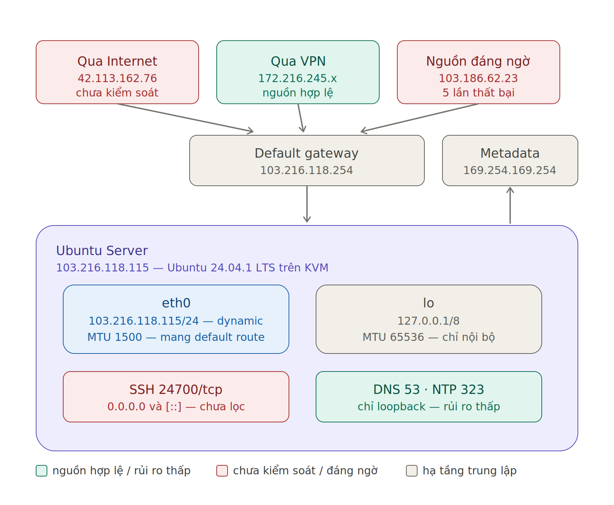

# Bài 1 – Khảo sát, lập bản đồ mạng và chuẩn hóa Ubuntu Server

> Tiếp nhận một Ubuntu Server chưa có hồ sơ hiện trạng, lập bản đồ hệ điều hành, mạng, route, DNS, cổng mở, dịch vụ, tài nguyên và lịch sử đăng nhập để một kỹ sư khác nắm được máy chủ đang có gì và rủi ro nào cần xử lý trước khi triển khai ứng dụng.

## Đã làm

| Yêu cầu | Kết quả chính | Lệnh chính |
|---|---|---|
| Định danh hệ thống | Ubuntu 24.04.1 LTS, kernel 6.8, chạy trên KVM/OpenStack; múi giờ đúng, đồng bộ thời gian bằng `chrony` | `hostnamectl`, `timedatectl` |
| Interface mạng | 2 interface (`lo`, `eth0`); IPv4 cấp qua DHCP (có lease); chỉ có IPv6 link-local; không có interface VPN | `ip a` |
| Định tuyến | Default gateway qua `eth0`; dùng `ip route get` để chứng minh đường đi tới Internet và tới cùng subnet | `ip route`, `ip route get` |
| DNS | Stub resolver `127.0.0.53` chuyển tiếp tới uplink DNS; phân biệt lỗi DNS với mất mạng | `resolvectl`, `nslookup`, `dig @<server>` |
| Cổng lắng nghe | Bảng Port – Protocol – Address – Process – PID – User – Mục đích cho toàn bộ cổng TCP/UDP; phân loại cổng cần giữ và cổng cần giảng viên xác nhận | `ss -tulnpe` |
| Dịch vụ | 22 service đang chạy, 0 service lỗi; đề xuất tắt các service thừa trên VM (ModemManager, udisks2, upower, thermald…) | `systemctl`, `list-unit-files` |
| Tài nguyên | 1 vCPU, ~1,9 GiB RAM, không có swap; filesystem gốc dùng 18% (inode 2%) | `lscpu`, `free`, `df -h`, `df -i`, `du` |
| Phiên đăng nhập | Thống kê đăng nhập thành công và thất bại theo IP nguồn | `last`, `lastb`, `who`, `w` |

Bốn kịch bản kiểm thử bắt buộc đã có trong báo cáo: truy cập qua IP công cộng và qua VPN, dừng rồi khôi phục một service không thiết yếu (`chrony`), giả lập lỗi DNS không phá cấu hình, và xác định tiến trình tiêu thụ tài nguyên.

## Phát hiện đáng chú ý

- **SSH chạy theo socket activation.** `ssh.service` không nằm trong danh sách enabled nhưng `ssh.socket` thì đang active, nên cổng SSH được khai báo ở systemd chứ không phải `sshd_config`. Phát hiện này ảnh hưởng tới cách cấu hình Fail2ban ở Bài 4.
- **Server không phân biệt được VPN với Internet ở tầng route.** Không có interface VPN, mọi lưu lượng vào qua `eth0`, nên chính sách truy cập phải dựng bằng firewall theo IP nguồn (Bài 2).
- **Cổng SSH mở trên `0.0.0.0` và `[::]`, chưa có rule lọc.** Đây là rủi ro ưu tiên cao nhất ở thời điểm khảo sát.
- **Không có swap trên máy 1,9 GiB RAM.** Khi hết bộ nhớ, OOM killer sẽ dừng tiến trình ngay. Điều này được đưa vào cân nhắc khi giới hạn RAM cho container ở Bài 5.
- **Toàn bộ đăng nhập đều dùng `root`**, chỉ có một phiên SSH mở, không có phiên dự phòng.

## Sự cố và bài học

- Đọc đúng cột `free` và `available`: `free` chỉ là RAM chưa cấp phát, `available` mới là RAM thực sự còn dùng được.
- `ss` chỉ in `uid:` cho user khác root; dòng thiếu `uid:` nghĩa là tiến trình chạy bằng root.
- Sau khi dừng `chrony`, dòng `System clock synchronized` vẫn là `yes` còn `NTP service` chuyển `inactive`. Hai chỉ báo này khác nhau, nên phải đọc cả hai.

## Còn dang dở

- Yêu cầu 10 và 11 (chuẩn hóa server, bảng trước/sau) chưa có mục riêng trong báo cáo. Hostname đã được đổi nhưng chỉ có dấu vết trong log.
- Danh sách tối thiểu 5 rủi ro xếp theo ưu tiên chưa được gộp thành một bảng.
- Chưa chạy `traceroute`/`tracepath`; một số ô trong KT2 và KT4 còn ghi "(điền)".
- Thiếu ảnh EV-13 và EV-16 đến EV-18; `06_Checklist.txt` và `03_Cau_hinh/` đang trống.

## Hồ sơ

| File / thư mục | Nội dung |
|---|---|
| [01_Bao_cao.docx](01_Bao_cao.docx) | Báo cáo kỹ thuật |
| [02_Lenh_da_su_dung.txt](02_Lenh_da_su_dung.txt) | Lệnh đã dùng theo từng yêu cầu |
| [04_Log/](04_Log/) | Trích log hệ thống trong lúc kiểm thử |
| [05_Minh_chung/](05_Minh_chung/) | Ảnh minh chứng `EV-xx`, sơ đồ `SD-01` và [bản tổng hợp PDF](05_Minh_chung/00_Ho_so_minh_chung.pdf) |
