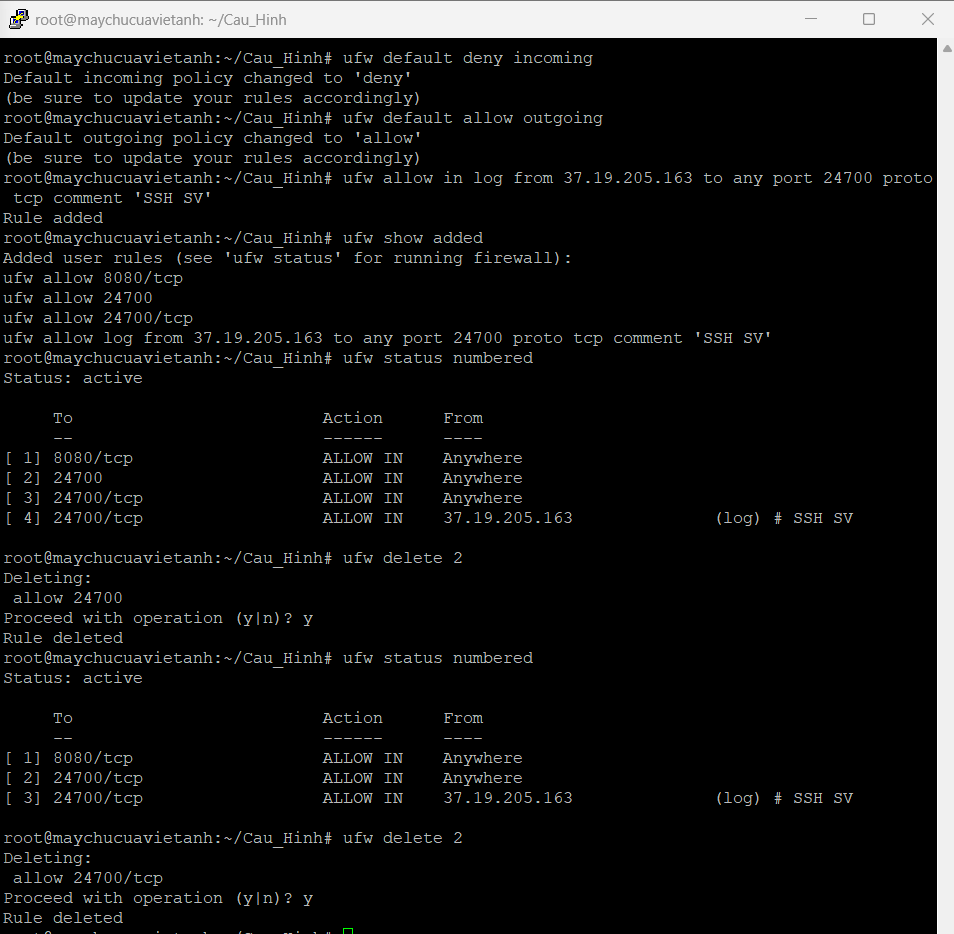
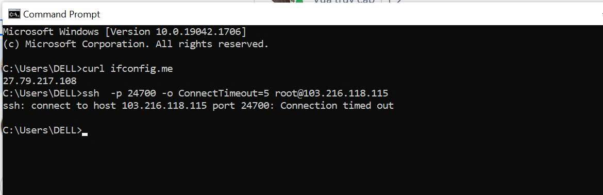

# Bài 2 – Thiết lập whitelist và blacklist truy cập theo VPN

> Server đang cho SSH từ mọi địa chỉ Internet. Chuyển sang mô hình quản trị qua VPN bằng firewall UFW: chỉ nguồn trong whitelist được SSH, nguồn khác bị chặn và có log, chính sách có thứ tự và không tự khóa quyền truy cập của chính mình.

## Đã làm

- **Chọn một công cụ duy nhất (UFW)** để tránh xung đột giữa nhiều cơ chế firewall.
- **Sao lưu cấu hình trước khi đổi:** `ufw status`, `iptables-save`, `ip6tables-save` và `cp -a /etc/ufw`.
- **Đặt default policy:** `deny incoming`, `allow outgoing`.
- **Thêm whitelist SSH cho VPN cá nhân (có ghi log) trước khi xóa** hai rule đang mở SSH cho mọi nguồn, nhờ đó đường quản trị không bị đứt trong lúc sửa.
- **Lập ma trận truy cập** (nguồn, đích, cổng, giao thức, hành động, lý do) và giải thích thứ tự xử lý của UFW: `before.rules`, user rules theo thứ tự, `after.rules`, rồi default policy.
- **Kiểm thử và thu log:** một nguồn trong whitelist và một nguồn Internet ngoài whitelist, kèm bản ghi `[UFW ALLOW]` và `[UFW BLOCK]`.
- **Viết quy trình khôi phục khi tự khóa SSH** qua Web Console (VNC) của nhà cung cấp.

## Kết quả

| Kiểm thử | Kết quả |
|---|---|
| SSH từ VPN cá nhân (trong whitelist) | Đạt: đăng nhập thành công, firewall ghi `[UFW ALLOW]` |
| SSH từ Internet, không qua VPN | Đạt: `Connection timed out`, firewall ghi `[UFW BLOCK]` |

Tổng hợp trong báo cáo: 2 trường hợp đạt, 0 không đạt, 5 chờ thông số hoặc chưa thực hiện.

## Bài học

- **`ufw deny` dùng DROP nên client chỉ thấy timeout**, không thấy "connection refused". Từ phía client không phân biệt được cổng bị chặn với cổng không có dịch vụ.
- **Blacklist phải đứng trước mọi rule allow.** Dùng `ufw insert 1 deny ...`, vì `ufw deny ...` thêm rule xuống cuối danh sách và có thể bị rule allow rộng hơn khớp trước.
- **Kết nối đã thiết lập được chấp nhận trước blacklist.** Muốn cắt phiên đang mở phải dùng `ss -K dst <IP>`.
- **Số thứ tự rule thay đổi sau mỗi lần xóa**, nên phải chạy lại `ufw status numbered` trước khi xóa rule tiếp theo.
- **Whitelist dựa trên IP thoát của VPN.** Nếu nhà cung cấp VPN đổi IP này thì SSH bị khóa, đó là lý do phải có quy trình khôi phục.
- **Sự cố nhỏ trong sao lưu:** lệnh `cp -a /etc/ufw /etc/default/ufw` thiếu thư mục đích nên báo lỗi và không ghi đè gì; đã sao lưu lại bằng lệnh đúng (báo cáo mục 2.1).

## Còn dang dở

- Blacklist 3 IP, whitelist VPN giảng viên và rule dịch vụ theo dải VPN của lớp: chưa có thông số từ giảng viên.
- Cổng `8080/tcp` đang mở cho mọi nguồn, chưa xác định mục đích.
- Kiểm thử bền vững sau reboot (TC6) và kiểm tra IPv6.
- `03_Cau_hinh/`, `04_Log/` và `06_Checklist.txt` đang trống.
- Bảng rule chụp ở Bài 5 cho thấy rule SSH mở cho mọi nguồn xuất hiện lại, cần rà soát whitelist sau mỗi lần thay đổi.

## Hồ sơ

| File / thư mục | Nội dung |
|---|---|
| [01_Bao_cao.pdf](01_Bao_cao.pdf) | Báo cáo: ma trận, cấu hình trước/sau, biên bản kiểm thử, log, quy trình khôi phục |
| [02_Lenh_da_su_dung.txt](02_Lenh_da_su_dung.txt) | Lệnh đã dùng theo từng yêu cầu |
| [05_Minh_chung/](05_Minh_chung/) | Ảnh `MC-01` đến `MC-06` và [hồ sơ minh chứng có chú thích](05_Minh_chung/00_Ho_so_minh_chung.pdf) |
