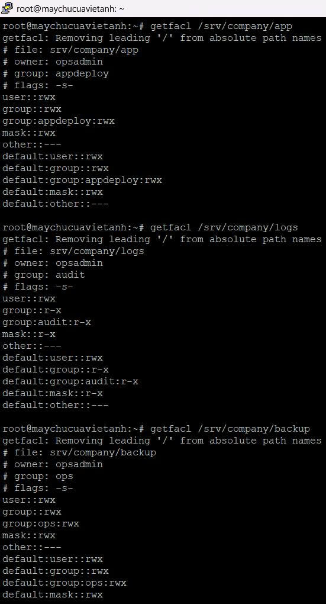
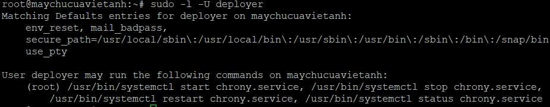

# Bài 3 – Phân quyền Linux theo vai trò và kiểm soát truy cập thư mục

> Dự án đang dùng chung một tài khoản có sudo cho cả ba nhóm nhân sự, nên không biết ai đã đổi file và ai cũng xóa được dữ liệu. Thiết kế lại theo nguyên tắc đặc quyền tối thiểu: mỗi người một tài khoản, quyền cấp qua group vai trò, thư mục khóa bằng permission kết hợp ACL, sudo chỉ cấp đúng lệnh cần.

## Đã làm

- **4 tài khoản, 3 group vai trò:** `opsadmin` (quản trị), `deployer` (triển khai), `auditor` (kiểm toán), `guestlab` (khách, không group nghiệp vụ); group `ops`, `appdeploy`, `audit`.
- **3 thư mục nghiệp vụ** dưới `/srv/company`, kết hợp permission, setgid và default ACL:

| Thư mục | Mode | Ai được vào |
|---|---|---|
| `app` | `2770` | `deployer` đọc/ghi qua `appdeploy` |
| `logs` | `2750` | `auditor` chỉ đọc qua `audit` |
| `backup` | `2770` | chỉ nhóm `ops` |

- **`namei -l`** để kiểm tra quyền `x` trên từng cấp của đường dẫn.
- **Sudoers cho `deployer`:** đúng 4 lệnh `systemctl` cố định cho `chrony.service`, viết bằng đường dẫn tuyệt đối, không `NOPASSWD`, không `ALL`, soạn bằng `visudo`.
- **Phân tích rủi ro group `docker`:** thành viên group này tương đương root nên không thêm tài khoản nào vào.

## Kết quả

Mỗi tài khoản đăng nhập SSH riêng và thử vào 3 thư mục: 8 trường hợp đạt, 1 trường hợp không hợp lệ (S2). Checklist tự chấm: **17/33 đạt, 5 không đạt, 11 chưa có minh chứng**.

## Sự cố và bài học

| Mã | Mức | Vấn đề | Trạng thái |
|---|---|---|---|
| S1 | Cao | `auditor` và `guestlab` nằm trong group `sudo`, làm vô hiệu toàn bộ ACL. Phát hiện khi đối chiếu `id` với thiết kế | Cách khắc phục đã nêu, chưa có minh chứng |
| S2 | Trung bình | Lệnh kiểm thử dùng đường dẫn tương đối nên kết quả không hợp lệ; shell `dash` chỉ báo `can't cd` mà không nêu lý do | Đã sửa cách kiểm thử, chưa chạy lại |
| S3 | Trung bình | Cấu hình và thu minh chứng bằng phiên root, không truy vết được theo người | Chưa khắc phục |

Bài học rút ra:

- Setgid bảo đảm đúng group sở hữu, còn default ACL bảo đảm đúng bộ quyền; kernel dùng default ACL thay cho `umask` của người tạo.
- `mask` trong ACL là giới hạn trên cho quyền của group, nên `logs` có `mask r-x` thì `auditor` không ghi được.
- Kiểm thử phân quyền phải loại trừ `sudo`, nếu không kết quả không phản ánh đúng thiết kế.
- Dùng đường dẫn tuyệt đối khi kiểm thử để phân biệt "thiếu quyền" với "sai đường dẫn".

## Còn dang dở

Khắc phục S1 và thu lại `id`, `sudo -l`; kiểm thử ghi, đổi tên, xóa, `chmod`, `chown` bằng từng tài khoản; chứng minh kế thừa group và ACL cho file mới; `journalctl _COMM=sudo`; cấu hình `umask`. Chi tiết trong [06_Checklist.txt](06_Checklist.txt).

## Hồ sơ

| File / thư mục | Nội dung |
|---|---|
| [01_Bao_cao.pdf](01_Bao_cao.pdf) | Báo cáo kỹ thuật |
| [02_Lenh_da_su_dung.txt](02_Lenh_da_su_dung.txt) | Lệnh đã dùng, có chú thích |
| [03_Cau_hinh/](03_Cau_hinh/) | `getfacl`, `namei`, `sudo -l`, danh sách tài khoản và group |
| [04_Log/](04_Log/) | Bản chép text các phiên kiểm thử |
| [05_Minh_chung/](05_Minh_chung/) | Ảnh `MC-01` đến `MC-09` |
| [06_Checklist.txt](06_Checklist.txt) | 33 tiêu chí tự chấm |
