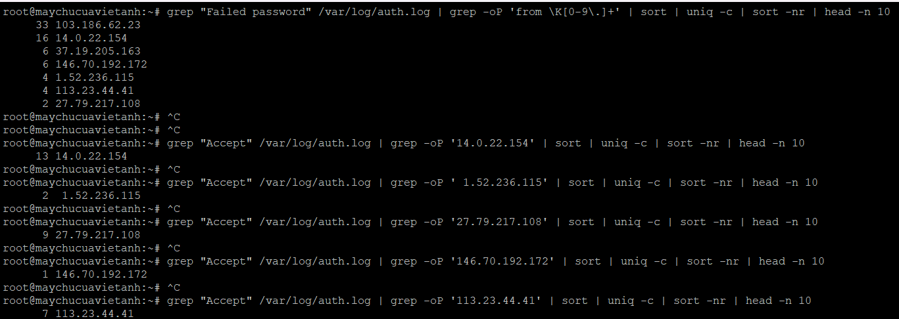
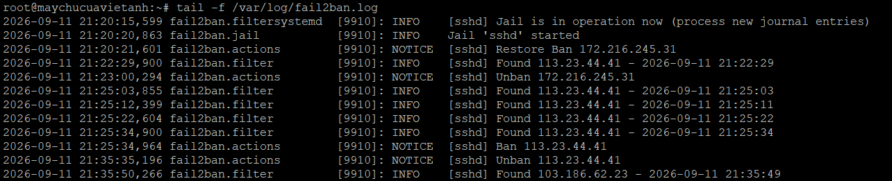

# Bài 4 – Điều tra truy cập SSH bất thường và xây dựng cơ chế chặn

> Bộ phận giám sát phát hiện nhiều lần đăng nhập SSH thất bại. Bảo toàn hiện trạng, phân tích log để tìm nguồn đáng ngờ, kết luận có hay không có dấu hiệu xâm nhập, lập blacklist và dựng cơ chế tự động chặn dò mật khẩu bằng Fail2ban. Toàn bộ chỉ ở góc độ phòng thủ trên server được cấp.

## Đã làm

- **Ghi nhận hiện trạng lúc bắt đầu điều tra:** thời điểm, uptime, người dùng đang online, kết nối đang mở.
- **Phân tích log từ nhiều nguồn** (`auth.log`, `last`, `lastb`): thống kê thất bại theo IP và theo username, đối chiếu với 45 phiên đăng nhập thành công từ 12 IP.
- **Kiểm tra tiến trình, cổng và service** để tìm dấu hiệu bám trụ sau xâm nhập.
- **Phân loại nguồn truy cập** thành 4 nhóm (hợp lệ, hợp lệ do sinh viên xác nhận, chưa xác định, nghi ngờ) kèm căn cứ log, rồi lập blacklist có lý do và thời hạn.
- **Cài Fail2ban** (jail `sshd`: 5 lần thất bại trong 10 phút thì ban 10 phút) và kiểm thử ban/unban.
- **Viết timeline sự kiện** và đề xuất phòng ngừa ở mức hệ thống và mức quy trình.

## Kết luận điều tra

- Có **một nguồn dò mật khẩu `root` kéo dài ít nhất 4 ngày** (33 lần thất bại, 0 phiên thành công). Chưa phát hiện dấu hiệu xâm nhập ở mức kiểm tra cơ bản: không có tiến trình, cổng hay service lạ.
- **Chưa thể khẳng định "không bị xâm nhập"**, vì còn 7 IP có phiên `root` thành công chưa xác nhận chủ sở hữu, chưa xem nội dung cron, và `root` vẫn đăng nhập bằng mật khẩu từ Internet.
- Fail2ban ban/unban đúng thời hạn trong log (ban lúc 21:25:34, unban lúc 21:35:35, đúng 10 phút).

## Phát hiện đáng giá và sự cố

| Mã | Mức | Vấn đề | Trạng thái |
|---|---|---|---|
| S1 | Cao | Jail đặt `port = ssh` (tra ra cổng 22) trong khi SSH chạy cổng khác, nên log ghi `Ban` nhưng rule chặn trỏ sai cổng | Chưa khắc phục |
| S2 | Trung bình | Kiểm thử ban trúng IP quản trị vì chưa có `ignoreip` | Chưa khắc phục |
| S3 | Trung bình | Số liệu thống kê bị nhiễm bởi chính lệnh `grep` của người điều tra (sudo ghi lệnh vào `auth.log`) | Đã sửa cho thống kê IP |
| S4 | Trung bình | Điều tra bằng root, phiên root trên console bỏ ngỏ gần 17 giờ | Chưa khắc phục |

Bài học rút ra:

- **Dò mật khẩu chậm (low-and-slow) lọt dưới ngưỡng Fail2ban.** Nguồn tấn công cách nhau tối thiểu 22 phút mỗi lần thử nên không bao giờ đạt ngưỡng 5 lần/10 phút. Đề xuất thêm jail thứ hai với `findtime = 1d`.
- **Log `Ban` chỉ chứng minh Fail2ban đã ra lệnh**, chưa chứng minh kết nối thực sự bị chặn. Phải kiểm tra rule firewall và thử kết nối từ IP bị ban.
- **Backend `systemd` chỉ xử lý bản ghi mới**, không quét lại lịch sử, nên sau khi cài jail báo `Total failed: 0` dù log đã có hơn 70 lần thất bại.
- **Phân tích trên log đang ghi dễ bị nhiễm**; nên sao chép log kèm `sha256sum` trước rồi phân tích trên bản sao.
- Dùng `-oP 'from \K[0-9.]+'` thay vì `awk '{print $(NF-3)}'` để chỉ lấy đúng IP.

## Còn dang dở

Sao lưu log kèm SHA256, chạy lại thống kê username có lọc `sshd`, xác nhận 7 IP chưa rõ chủ, kiểm tra cron, áp dụng blacklist và chứng minh bị chặn, sửa S1/S2, kiểm tra sau reboot. 27/36 tiêu chí đạt, 2 không đạt, 7 chưa có minh chứng; chi tiết trong [06_Checklist.txt](06_Checklist.txt).

## Hồ sơ

| File / thư mục | Nội dung |
|---|---|
| [01_Bao_cao.pdf](01_Bao_cao.pdf) | Báo cáo sự cố: timeline, phân loại, blacklist, đề xuất |
| [02_Lenh_da_su_dung.txt](02_Lenh_da_su_dung.txt) | Lệnh đã dùng, có chú thích |
| [03_Cau_hinh/](03_Cau_hinh/) | `jail.local`, trạng thái Fail2ban |
| [04_Log/](04_Log/) | Bản chép text của các ảnh minh chứng để đọc và `grep` được |
| [05_Minh_chung/](05_Minh_chung/) | Ảnh `MC-01` đến `MC-10` |
| [06_Checklist.txt](06_Checklist.txt) | 36 tiêu chí tự chấm |
