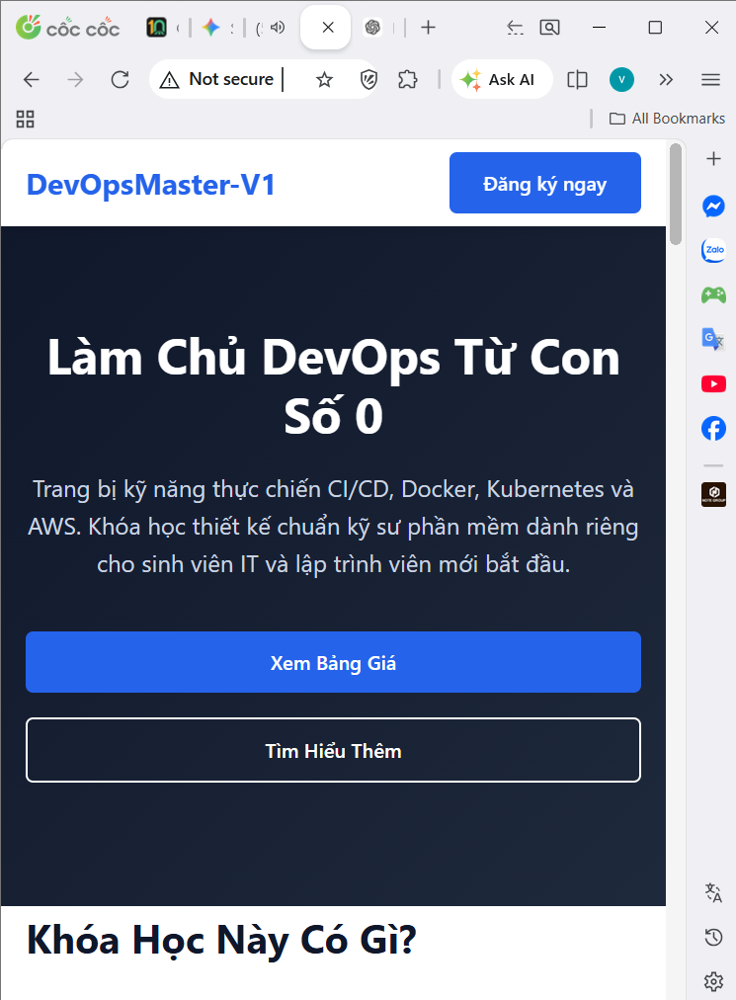
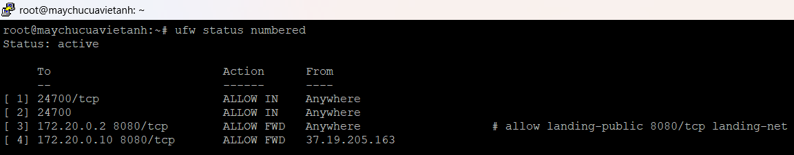

# Bài 5 – Triển khai landing page bằng AI và Docker

> Dựng nhanh một landing page giới thiệu khóa học để chạy thử chiến dịch marketing. Trọng tâm không phải viết code mà là cách đóng gói image, quản lý phiên bản, publish cổng, phân tách truy cập public và preview, restart policy và khả năng nâng cấp, quay lui.

Sản phẩm: landing page khóa học "Làm Chủ DevOps Từ Con Số 0" (HTML/CSS/JS tĩnh sinh bằng AI rồi thay toàn bộ nội dung mẫu). Trang không có form gửi dữ liệu thật và không có thanh toán.

## Đã làm

- **Image tự build từ Dockerfile** trên nền `busybox:stable` (chạy `httpd` tích hợp, không dùng Nginx hay Apache), image chỉ 6,72 MB. `docker history` cho thấy từng layer.
- **Hai phiên bản image:** `devops-landing:v1.0` và `v1.1`, trong đó v1.1 đổi tên thương hiệu trên thanh điều hướng để nhìn thấy ngay trên giao diện.
- **Hai container trên network riêng:** `landing-public` (cổng `8080`, mở cho Internet) và `landing-preview` (cổng `8081`, chỉ mở cho VPN).
- **Phân tách truy cập bằng firewall** với `ufw route` (hiển thị `ALLOW FWD`) trỏ tới IP của container.
- **Restart policy `unless-stopped`**, chứng minh bằng `systemctl restart docker`: thời gian `CREATED` giữ nguyên còn `STATUS` là "Up vài giây".
- **Nâng cấp v1.0 lên v1.1** mà vẫn giữ image v1.0 để có thể quay lui.

## Kết quả kiểm thử

| Nguồn truy cập | Public (8080) | Preview (8081) | Đánh giá |
|---|---|---|---|
| Internet công cộng | Vào được | Timeout | Đạt |
| VPN cá nhân | Vào được | Vào được | Đạt |
| Nguồn lạ ngoài whitelist | Vào được | Timeout | Đạt |
| VPN giảng viên, SSH từ Internet | Chưa kiểm thử | Chưa kiểm thử | Chưa có minh chứng |

Checklist tự chấm: **26/45 đạt, 2 không đạt, 17 chưa có minh chứng**.

## Bài học

- **Traffic tới container đi qua chain `FORWARD`, không qua `INPUT`.** Docker tạo rule DNAT nên `ufw deny 8081` không có tác dụng; phải dùng `ufw route` (`ALLOW FWD`) trỏ tới IP container.
- **Timeout khác "connection refused".** `curl: (28)` cho biết gói tin bị `DROP` im lặng; `REJECT` sẽ báo từ chối ngay. Từ lỗi phía client có thể suy ra loại rule phía server.
- **Gắn tag phiên bản thay vì ghi đè `latest`**, nên rollback chỉ là chạy lại container với tag cũ, không cần build lại.
- **`unless-stopped` tôn trọng quyết định dừng thủ công** của người vận hành, khác với `always`.
- **`httpd -f` phải chạy foreground**, nếu không tiến trình chính thoát và container dừng ngay.

## Sự cố ghi nhận

| Mã | Mức | Vấn đề |
|---|---|---|
| S1 | Cao | SSH vẫn mở từ mọi địa chỉ Internet, trái yêu cầu chỉ cho whitelist VPN |
| S2 | Cao | Preview chỉ mở cho một IP `/32` thay vì dải VPN của lớp, nên VPN giảng viên có thể bị chặn |
| S3 | Trung bình | Rule gắn cứng vào IP container, tạo lại container có thể nhận IP khác; hướng xử lý là `--ip` tĩnh |
| S4 | Trung bình | Chưa đặt giới hạn CPU/RAM cho container |
| S5 | Trung bình | Triển khai bằng phiên root, không truy vết theo người |

Các sự cố này chưa được khắc phục; cách xử lý đề xuất nằm trong báo cáo mục 6.

## Còn dang dở

Nộp source landing page và Dockerfile thật (hiện mới có bản suy ra từ `docker history`), prompt AI đã dùng, giới hạn tài nguyên và `docker stats`, `docker logs`, rollback về v1.0, kiểm thử sau reboot, sao lưu image bằng `docker save`.

## Hồ sơ

| File / thư mục | Nội dung |
|---|---|
| [01_Bao_cao.pdf](01_Bao_cao.pdf) | Báo cáo kỹ thuật, kèm checklist bàn giao cho đội vận hành |
| [02_Lenh_da_su_dung.txt](02_Lenh_da_su_dung.txt) | Lệnh đã dùng, có chú thích |
| [03_Cau_hinh/](03_Cau_hinh/) | Dockerfile suy ra, danh sách image/container, rule UFW |
| [04_Log/](04_Log/) | Bản chép text các lần kiểm thử, nâng cấp, restart Docker |
| [05_Minh_chung/](05_Minh_chung/) | Ảnh `MC-01` đến `MC-13` |
| [06_Checklist.txt](06_Checklist.txt) | 45 tiêu chí tự chấm |
