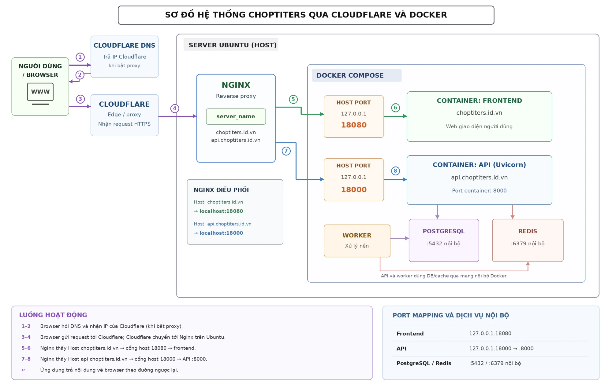
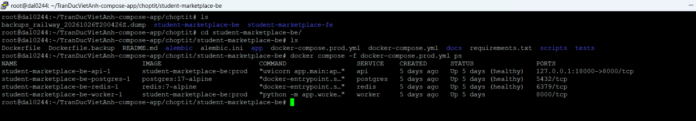
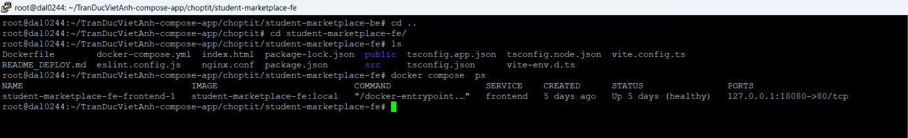
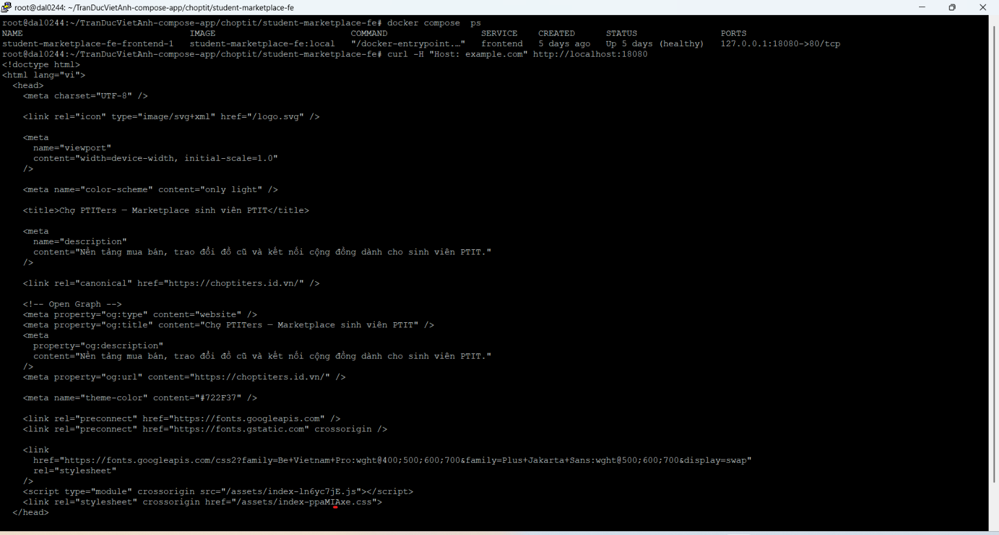
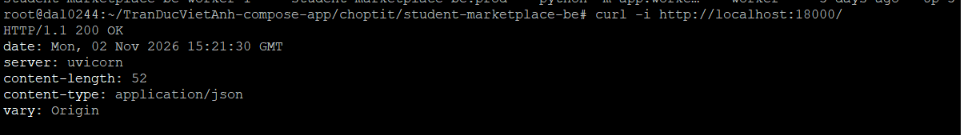
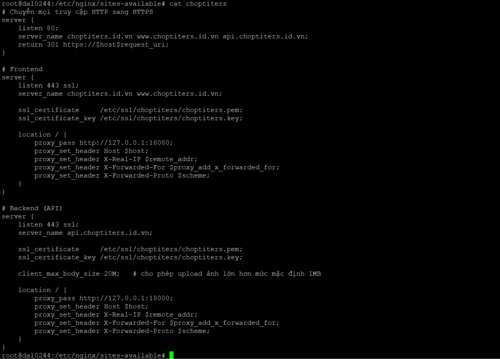
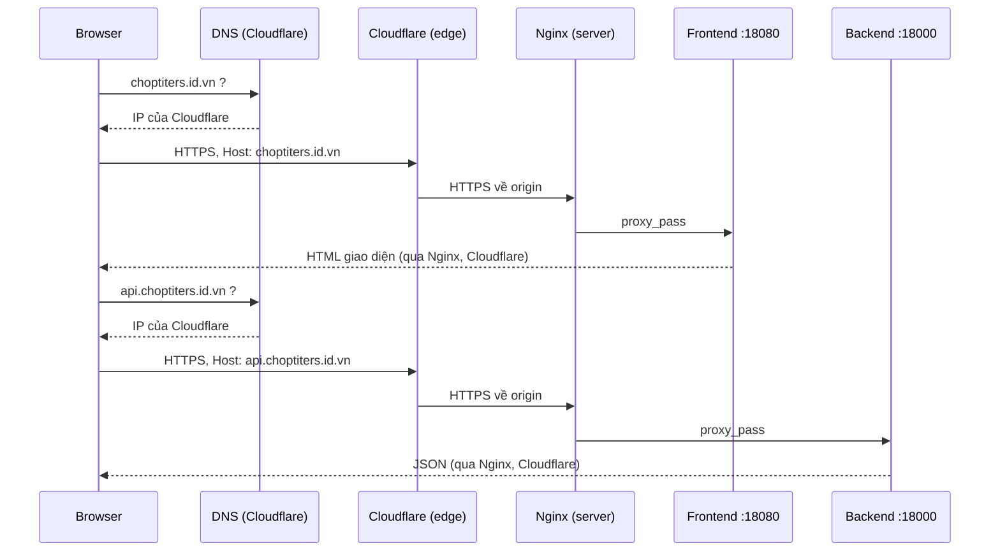

# BÀI 1: Dựng hệ thống web có domain/subdomain logic

> **Họ tên:** Trần Đức Việt Anh  
> **Hệ thống thực hành:** Chợ PTITers (`student-marketplace`) – marketplace sinh viên PTIT  
> **Domain:** `choptiters.id.vn`  
> **Server:** Ubuntu (`dal0244`), chạy Docker Compose + Nginx cài trực tiếp trên host

---

## 1. Mục tiêu

Tổ chức hệ thống theo mô hình:

| Tên miền | Vai trò | Service phía sau |
|---|---|---|
| `choptiters.id.vn`, `www.choptiters.id.vn` | Web giới thiệu / giao diện người dùng | Frontend (React + Vite, Nginx trong container) |
| `api.choptiters.id.vn` | API cho frontend và ứng dụng | Backend (FastAPI/Uvicorn) |

Đề yêu cầu tối thiểu 1 nginx reverse proxy + 2 service phía sau. Hệ thống em đang chạy thật đã thỏa mãn và còn có thêm PostgreSQL, Redis, Worker.

---

## 2. Kiến trúc tổng quan



Điểm chính:

- **Chỉ Nginx mở ra Internet** (port 80/443). Các container chỉ bind vào `127.0.0.1` nên không ai truy cập trực tiếp từ ngoài được.
- Nginx phân biệt web và API bằng **`server_name`** (Host header).
- PostgreSQL, Redis và Worker nằm trong mạng nội bộ Docker, không publish ra host.

---

## 3. Bằng chứng thực hiện

### 3.1. Backend – `docker compose ps` (port 18000)

Chạy trong thư mục `student-marketplace-be` với file `docker-compose.prod.yml`:

```bash
cd ~/TranDucVietAnh-compose-app/choptit/student-marketplace-be
docker compose -f docker-compose.prod.yml ps
```



Nhận xét:

- 4 container đều `Up 5 days (healthy)` (riêng worker không có healthcheck): `api`, `postgres`, `redis`, `worker`.
- `api` publish **`127.0.0.1:18000->8000`**: chỉ lắng nghe trên loopback.
- `postgres` (5432) và `redis` (6379) chỉ hiện port nội bộ container, **không map ra host**, nên không bị lộ.

### 3.2. Frontend – `docker compose ps` (port 18080)

```bash
cd ~/TranDucVietAnh-compose-app/choptit/student-marketplace-fe
docker compose ps
```



Nhận xét: container `frontend` `Up 5 days (healthy)`, publish **`127.0.0.1:18080->80`**.

### 3.3. Test curl frontend

```bash
curl -H "Host: example.com" http://localhost:18080
```



Nhận xét: trả về HTML của trang **"Chợ PTITers – Marketplace sinh viên PTIT"**, tức frontend phản hồi bình thường qua port 18080.

> Lưu ý: lệnh này gọi thẳng vào container frontend (bỏ qua Nginx host) nên header `Host` không ảnh hưởng kết quả. Việc phân tách theo host do Nginx ở mục 3.5 đảm nhiệm.

### 3.4. Test curl backend

```bash
curl -i http://localhost:18000/
```



Nhận xét: `HTTP/1.1 200 OK`, `server: uvicorn`, `content-type: application/json` → backend FastAPI đang chạy và trả JSON.

### 3.5. File cấu hình Nginx (reverse proxy)

File `/etc/nginx/sites-available/choptiters`:



Nội dung cấu hình:

```nginx
# Chuyển mọi truy cập HTTP sang HTTPS
server {
    listen 80;
    server_name choptiters.id.vn www.choptiters.id.vn api.choptiters.id.vn;
    return 301 https://$host$request_uri;
}

# Frontend
server {
    listen 443 ssl;
    server_name choptiters.id.vn www.choptiters.id.vn;

    ssl_certificate     /etc/ssl/choptiters/choptiters.pem;
    ssl_certificate_key /etc/ssl/choptiters/choptiters.key;

    location / {
        proxy_pass http://127.0.0.1:18080;
        proxy_set_header Host $host;
        proxy_set_header X-Real-IP $remote_addr;
        proxy_set_header X-Forwarded-For $proxy_add_x_forwarded_for;
        proxy_set_header X-Forwarded-Proto $scheme;
    }
}

# Backend (API)
server {
    listen 443 ssl;
    server_name api.choptiters.id.vn;

    ssl_certificate     /etc/ssl/choptiters/choptiters.pem;
    ssl_certificate_key /etc/ssl/choptiters/choptiters.key;

    client_max_body_size 20M;   # cho phép upload ảnh lớn hơn mức mặc định 1MB

    location / {
        proxy_pass http://127.0.0.1:18000;
        proxy_set_header Host $host;
        proxy_set_header X-Real-IP $remote_addr;
        proxy_set_header X-Forwarded-For $proxy_add_x_forwarded_for;
        proxy_set_header X-Forwarded-Proto $scheme;
    }
}
```

Giải thích từng khối:

| Khối | Tác dụng |
|---|---|
| `listen 80` + `return 301` | Ép mọi truy cập HTTP chuyển sang HTTPS |
| `server_name choptiters.id.vn www...` | Request vào domain chính → proxy tới frontend `127.0.0.1:18080` |
| `server_name api.choptiters.id.vn` | Request vào subdomain API → proxy tới backend `127.0.0.1:18000` |
| `proxy_set_header Host / X-Forwarded-*` | Giữ host gốc và IP thật của client để app xử lý đúng |
| `client_max_body_size 20M` | Cho phép upload ảnh sản phẩm lớn hơn 1MB mặc định |

---

## 4. Nếu có domain thật: record/subdomain đi như thế nào?

Domain `choptiters.id.vn` được quản lý trên **Cloudflare** (Cloudflare làm DNS và đứng làm lớp edge phía trước server). Em tạo các bản ghi sau, **bật proxy (đám mây cam)**:

| Type | Name | Value | Proxy | Mục đích |
|---|---|---|---|---|
| A | `@` (`choptiters.id.vn`) | `<IP_SERVER>` (origin) | Proxied | Web chính |
| CNAME | `www` | `choptiters.id.vn` | Proxied | Alias của web chính |
| A | `api` | `<IP_SERVER>` (origin) | Proxied | Subdomain API |

> `<IP_SERVER>` chỉ nằm trong cấu hình DNS của Cloudflare. Khi bật proxy, **người dùng bên ngoài không bao giờ thấy IP này**.

**Luồng phân giải khi người dùng truy cập:**

1. Browser hỏi DNS: `api.choptiters.id.vn` là IP nào? → DNS trả về **IP của Cloudflare** (không phải IP server).
2. Browser kết nối HTTPS tới Cloudflare, kèm `Host: api.choptiters.id.vn`.
3. Cloudflare tra bản ghi của host đó, rồi chuyển request về **origin** (`<IP_SERVER>`, port 443).
4. Nginx trên server đọc Host header, khớp `server_name`, rồi `proxy_pass` tới đúng service (frontend `:18080` hoặc backend `:18000`).
5. Response đi ngược lại: service → Nginx → Cloudflare → Browser.



Việc ẩn origin IP và vai trò của Cloudflare được phân tích kỹ hơn ở Bài 2.

---

## 5. Giải thích ngắn: subdomain dùng để làm gì trong hệ thống này?

Subdomain giúp **tách các dịch vụ có vai trò khác nhau trên cùng một domain và cùng một server**:

- **`choptiters.id.vn`**: giao diện người dùng (frontend), phục vụ file tĩnh HTML/JS/CSS.
- **`api.choptiters.id.vn`**: backend API, xử lý nghiệp vụ, đăng nhập, upload ảnh, truy vấn dữ liệu.

Lợi ích của việc tách subdomain:

- Mỗi service có cấu hình riêng (ví dụ chỉ API cần `client_max_body_size 20M`).
- Dễ mở rộng thêm `admin.`, `staging.` mà không đụng service cũ.
- Dễ áp dụng chính sách bảo mật/CORS/rate limit riêng cho từng subdomain.
- Chỉ cần một IP và một chứng chỉ SSL dùng chung cho các host.

---

## 6. Kết luận

- Đã có **1 Nginx reverse proxy** + **2 service chính** (frontend, backend) chạy bằng Docker Compose, kèm DB/Redis/Worker nội bộ.
- Nginx route theo host: domain chính → frontend, `api.` → backend, HTTP tự động chuyển sang HTTPS.
- Các container bind `127.0.0.1`, DB/Redis không mở ra host → chỉ cửa vào duy nhất là Nginx.
- Đã kiểm tra bằng `docker compose ps` và `curl`: cả frontend (HTML) và backend (JSON 200) đều phản hồi đúng.

### Việc còn thiếu so với danh sách "Phải nộp"

- [x] Ảnh file nginx config
- [x] Ảnh `docker compose ps` (cả backend và frontend)
- [ ] Ảnh `curl` **qua đúng host/domain** (qua Nginx), hiện mới test thẳng vào port 18000/18080. Có thể chụp thêm:

```bash
curl -I https://choptiters.id.vn
curl -i https://api.choptiters.id.vn/
curl -I http://choptiters.id.vn          # kỳ vọng 301 -> https
```
- [x] Giải thích subdomain dùng để làm gì
