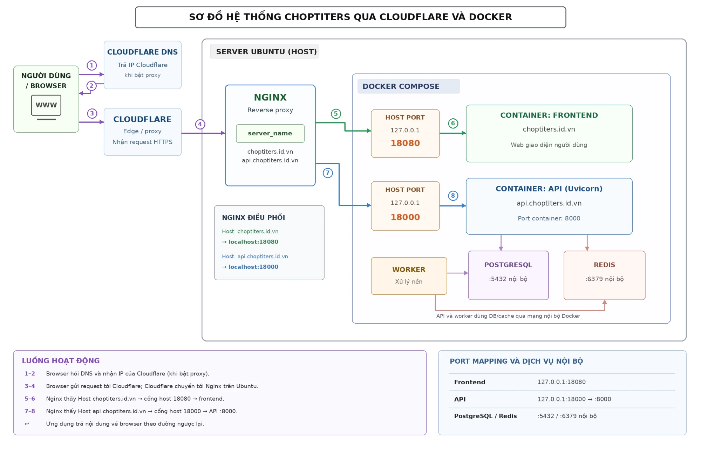

# BÀI 2: Vai trò của Cloudflare trong hệ thống đang chạy

> **Họ tên:** Trần Đức Việt Anh  
> **Hệ thống:** Chợ PTITers – `choptiters.id.vn`, `api.choptiters.id.vn`

## 1. Câu hỏi của lãnh đạo kỹ thuật

> "Cloudflare đứng ở đâu trong hệ thống của mình, nó làm gì, và vì sao không nên để lộ origin IP?"

---

## 2. Sơ đồ hệ thống

**Đọc sơ đồ:** người dùng không bao giờ nói chuyện trực tiếp với server. Mọi request đều đi qua Cloudflare, sau đó mới tới Nginx rồi tới container.

| Thành phần | Vai trò |
|---|---|
| User / Browser | Gửi request tới `choptiters.id.vn` hoặc `api.choptiters.id.vn` |
| Cloudflare | DNS + reverse proxy ở rìa mạng, đứng giữa user và server |
| Domain / subdomain | `choptiters.id.vn`, `www.`, `api.` – trỏ vào Cloudflare |
| Ubuntu server | Máy chủ origin, chứa Nginx và Docker |
| Nginx | Nhận request từ Cloudflare, chọn service theo `server_name` |
| App / container | `frontend` (18080), `api` (18000), `worker`, `postgres`, `redis` |

---

## 3. Cloudflare đứng ở đâu?

Cloudflare đứng **giữa người dùng và server origin**, là điểm đầu tiên request chạm tới:

`User → Cloudflare → Nginx (server) → Container`

Khi bản ghi DNS được bật proxy (đám mây cam), DNS của domain trả về **IP của Cloudflare**, không phải IP server.

## 4. Cloudflare làm gì?

| Chức năng | Ý nghĩa với hệ thống |
|---|---|
| **DNS** | Quản lý bản ghi `@`, `www`, `api` |
| **Reverse proxy** | Nhận request thay server, rồi chuyển về origin |
| **SSL/TLS** | Mã hóa HTTPS giữa user và Cloudflare, và giữa Cloudflare và origin |
| **CDN / cache** | Cache file tĩnh của frontend (JS, CSS, ảnh), giảm tải server và tải nhanh hơn |
| **Chống DDoS** | Hấp thụ lưu lượng tấn công trước khi tới server |
| **WAF / rate limit** | Chặn request độc hại, bot, giới hạn tần suất |
| **Ẩn origin IP** | Người ngoài chỉ thấy IP Cloudflare |

## 5. Vì sao không nên để lộ origin IP?

Nếu kẻ tấn công biết IP thật của server, họ có thể **đi vòng qua Cloudflare** và gọi thẳng vào server. Khi đó toàn bộ lớp bảo vệ ở trên mất tác dụng:

1. **Bỏ qua WAF và chống DDoS**: tấn công thẳng vào IP origin, server tự chịu hết lưu lượng.
2. **Dò quét port và dịch vụ**: scan SSH (22), các port dev/test, tìm lỗ hổng trực tiếp.
3. **Bỏ qua rate limit và bot protection**: brute force đăng nhập, spam API.
4. **Lộ thông tin hạ tầng**: nhà cung cấp, vị trí, các dịch vụ khác cùng IP.
5. **Khó khắc phục**: IP đã lộ thì phải đổi IP mới chắc chắn, rất tốn công.

Origin IP thường bị lộ qua: bản ghi DNS để **DNS only** (đám mây xám), lịch sử DNS cũ, subdomain quên bật proxy (vd `mail.`, `ftp.`), email gửi từ chính server, hoặc chứng chỉ SSL bị tra cứu.

## 6. Biện pháp giữ origin an toàn

Đã có sẵn trong hệ thống:

- Container chỉ bind `127.0.0.1` (`18000`, `18080`); Postgres và Redis không mở ra host. Chỉ Nginx nhận kết nối từ ngoài.
- Nginx ép HTTP chuyển sang HTTPS (`return 301`).

Đề xuất bổ sung:

- Firewall (`ufw`) chỉ cho phép port 80/443 **từ dải IP của Cloudflare**, chặn truy cập trực tiếp vào IP origin.
- Bật SSL/TLS mode **Full (strict)** với chứng chỉ origin trên server.
- Bật **Authenticated Origin Pulls**: Nginx chỉ nhận request có chứng chỉ của Cloudflare.
- Mọi bản ghi trỏ về server phải bật proxy, không để subdomain nào ở DNS only.
- Không gửi email trực tiếp từ IP server.

## 7. Kết luận ngắn

Cloudflare là lớp edge nằm trước server, vừa làm DNS vừa làm reverse proxy, giúp mã hóa, cache, chống DDoS và giấu origin IP. Giữ kín origin IP và khóa server chỉ nhận traffic từ Cloudflare là điều kiện để các lớp bảo vệ đó thực sự có hiệu lực.

---

### Danh sách nộp

- [x] Sơ đồ hệ thống (mục 2)
- [x] File tóm tắt: [bai2-cloudflare-summary.txt](bai2-cloudflare-summary.txt)
