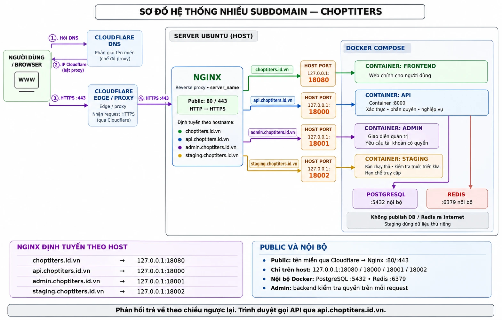

# BÀI 4: Thiết kế mô hình nhiều subdomain chạy song song

> **Họ tên:** Trần Đức Việt Anh  
> **Hệ thống:** Chợ PTITers – domain chính `choptiters.id.vn`

---

## 1. Yêu cầu

Chạy song song trên cùng một domain chính: web chính, API, admin, staging.

## 2. Sơ đồ hệ thống

## 3. Chức năng từng subdomain

| Tên miền | Container nhận request (host port) | Vai trò |
|---|---|---|
| `choptiters.id.vn` | `127.0.0.1:18080` | Web chính cho người dùng |
| `api.choptiters.id.vn` | `127.0.0.1:18000` | API phục vụ frontend, ứng dụng mobile… |
| `admin.choptiters.id.vn` | `127.0.0.1:18001` | Trang quản trị: quản lý tài khoản, sản phẩm, đơn hàng |
| `staging.choptiters.id.vn` | `127.0.0.1:18002` | Bản chạy thử để đội phát triển và tester kiểm tra tính năng trước khi đưa lên web chính |

## 4. Service nào public, service nào nội bộ

| Nhóm | Thành phần |
|---|---|
| **Public** | Các tên miền đi qua Cloudflare, vào Nginx ở port 80/443 |
| **Chỉ trên host** | `127.0.0.1:18080`, `18000`, `18001`, `18002` (chỉ Nginx gọi được) |
| **Nội bộ Docker** | PostgreSQL `:5432`, Redis `:6379`, không publish ra Internet |

Ghi chú:

- Chỉ các service HTTP/HTTPS được public; mọi service còn lại hoàn toàn nội bộ và người dùng chỉ truy cập thông qua reverse proxy.
- Staging dùng dữ liệu thử riêng, tách khỏi dữ liệu thật.
- Admin: backend kiểm tra quyền trên mỗi request.

## 5. Mô tả luồng hoạt động

Luồng đi: **User → Cloudflare → Nginx (trong server) → container tương ứng**.

1. Người dùng hỏi DNS, Cloudflare trả về IP của Cloudflare (chế độ proxy).
2. Người dùng gửi request HTTPS (port 443) tới Cloudflare.
3. Cloudflare chuyển tiếp request về Nginx nằm trong server Ubuntu.
4. Nginx dựa vào tên miền mà người dùng truy cập (`server_name`) để điều phối tới container xử lý request của tên miền đó:
   - `choptiters.id.vn` → `127.0.0.1:18080` (frontend)
   - `api.choptiters.id.vn` → `127.0.0.1:18000` (API)
   - `admin.choptiters.id.vn` → `127.0.0.1:18001` (admin)
   - `staging.choptiters.id.vn` → `127.0.0.1:18002` (staging)
5. Phản hồi trả về theo chiều ngược lại. Trình duyệt gọi API qua `api.choptiters.id.vn`.

## 6. Giải thích: Nginx + Docker Compose route ra sao

- Nginx nhận HTTP/HTTPS ở port 80/443 và đọc hostname để định tuyến.
- Mỗi container publish port ra host nhưng chỉ bind `127.0.0.1`, nên chỉ Nginx trên cùng máy mới gọi được.
- API (container port 8000) và các container khác dùng PostgreSQL, Redis qua mạng nội bộ Docker Compose.

---

### Danh sách nộp

- [x] Sơ đồ (mục 2)
- [x] Mô tả chức năng subdomain, service, public/nội bộ (mục 3, 4)
- [x] Mô tả luồng và cách route Nginx + Docker Compose (mục 5, 6)
