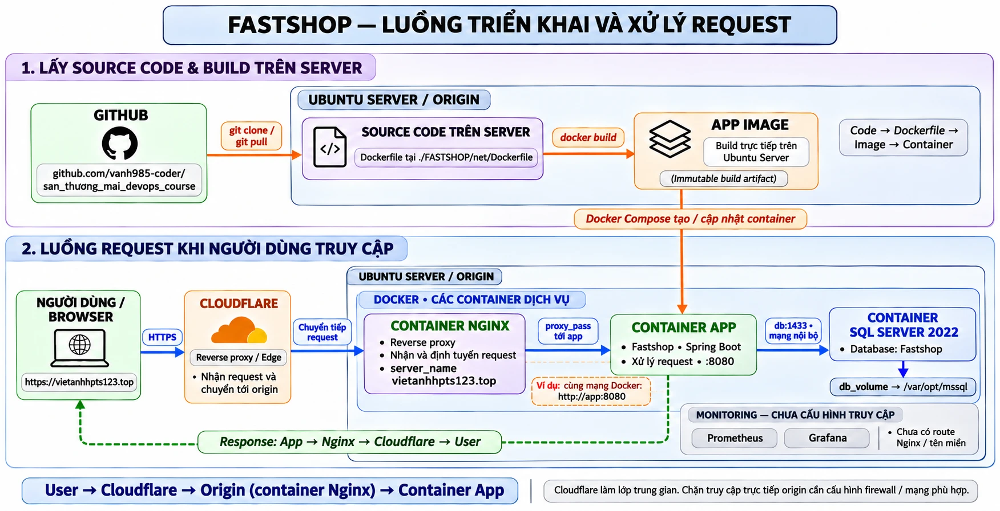

# BÀI 8: Sơ đồ pipeline cơ bản cho hệ thống

> **Họ tên:** Trần Đức Việt Anh  
> **Ứng dụng:** FASTSHOP

## 1. Sơ đồ pipeline



## 2. Các thành phần

| Câu hỏi của đề | Trả lời |
|---|---|
| Code đi từ đâu | GitHub: https://github.com/vanh985-coder/san_thuong_mai_devops_course |
| Image được build ở đâu | Build trên **server Ubuntu**, trong thư mục `./FASTSHOP/net` |
| Container chạy ở đâu | Trên server Ubuntu, bằng Docker Compose |
| Nginx đứng ở đâu | Nhận request rồi phân phối tới dịch vụ tương ứng (`proxy_pass` tới app). Nginx chạy **dạng container trong server** (cùng mạng Docker với app). |
| Cloudflare (edge) nằm ở đâu | **Giữa người dùng và server**; nhận request rồi chuyển tới server, để người dùng không tương tác trực tiếp với server |
| Domain/subdomain | `vietanhhpts123.top` |
| Dockerfile | Nằm trong `./FASTSHOP/net` |
| Code xuống server bằng cách nào | `git pull` từ GitHub |

## 3. Luồng request của người dùng

```
User / Browser → Cloudflare → Origin (thông qua Nginx) → Container
```

1. Người dùng gửi request tới domain.
2. Cloudflare đứng giữa nhận request, rồi chuyển tới server.
3. Tại server (origin), Nginx nhận request và phân phối tới dịch vụ tương ứng.
4. Container xử lý và trả phản hồi theo chiều ngược lại.

## 4. Luồng triển khai (pipeline)

```
Source code (GitHub) → git pull xuống server → Dockerfile → build image (trên server Ubuntu) → container (Docker Compose)
```

---

### Danh sách nộp

- [x] Ảnh sơ đồ luồng triển khai và request
- [x] Mô tả các thành phần và luồng
- [x] Domain: vietanhhpts123.top
