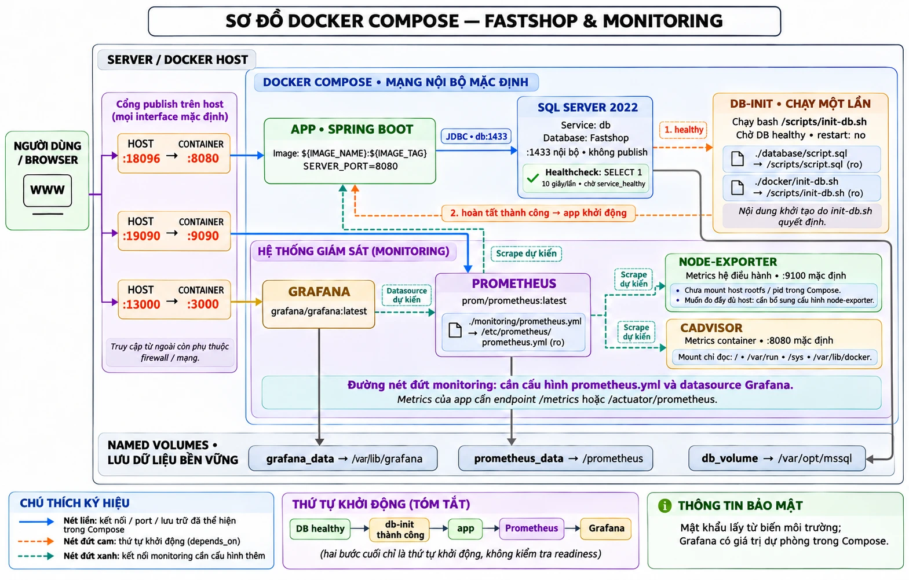
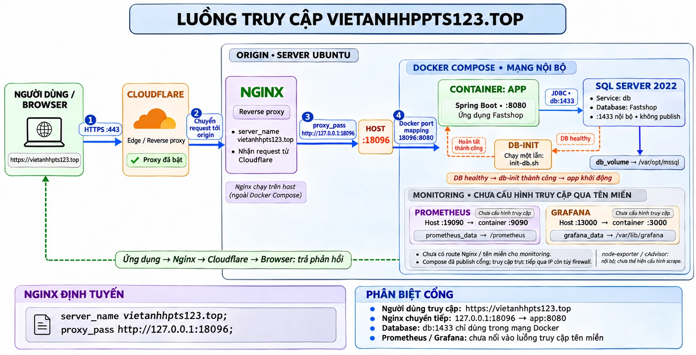
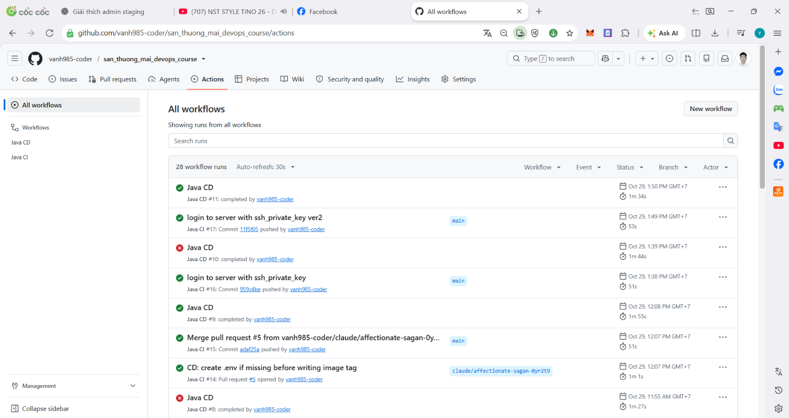

# BÀI 9: Đánh giá kiến trúc triển khai hiện tại

> **Họ tên:** Trần Đức Việt Anh  
> **Hệ thống:** FASTSHOP: https://vietanhhpts123.top  
> **File nộp:** [tong-hop.txt](tong-hop.txt)

## Phần 1 – Hệ thống hiện tại của em gồm gì



### 1. Server

- 1 server Ubuntu đóng vai trò origin, triển khai bằng Docker Compose.
- Mã nguồn: https://github.com/vanh985-coder/san_thuong_mai_devops_course (thư mục dự án `./FASTSHOP/net`, Dockerfile nằm trong thư mục này).

### 2. Service

| Service | Vai trò |
|---|---|
| `app` | Ứng dụng FASTSHOP (Spring Boot) |
| `db` | SQL Server 2022, database `Fastshop`, dữ liệu ở volume `db_volume` |
| `db-init` | Chạy một lần (`init-db.sh`) để khởi tạo database; app chỉ khởi động sau khi `db` healthy và `db-init` thành công |
| `prometheus` | Thu thập metrics |
| `grafana` | Hiển thị dashboard |
| `node-exporter` | Metrics của hệ điều hành |
| `cadvisor` | Metrics của container |

### 3. Port

| Port host | → Container | Thành phần |
|---|---|---|
| `18096` | `8080` | app |
| `19090` | `9090` | Prometheus |
| `13000` | `3000` | Grafana |
| không publish | `1433` | SQL Server, chỉ trong mạng Docker |

### 4. Nginx

- Nginx chạy trên host của server, ngoài Docker Compose.
- `server_name vietanhhpts123.top`, `proxy_pass http://127.0.0.1:18096` (port host map vào app:8080).

### 5. Domain / subdomain

- Domain chính: `vietanhhpts123.top`.

### 6. Cloudflare

- Domain đã được kết nối với Cloudflare, đứng giữa người dùng và server, nhận request rồi chuyển về origin.

---

## Phần 2 – Luồng truy cập hệ thống



**Tóm tắt luồng:** `User/Browser → Cloudflare → Origin (Nginx) → Container app → SQL Server`

| Câu hỏi | Trả lời |
|---|---|
| User đi vào đâu | Mở trình duyệt, truy cập `https://vietanhhpts123.top` |
| Request đi qua đâu | Browser hỏi DNS và nhận IP của Cloudflare, gửi HTTPS tới Cloudflare (reverse proxy / edge), Cloudflare chuyển tiếp về origin (server Ubuntu). Người dùng không tương tác trực tiếp với server |
| Nginx route vào đâu | Nginx nhận request, dựa vào `server_name vietanhhpts123.top` rồi `proxy_pass http://127.0.0.1:18096`, port host này map vào container `app` (Spring Boot, port 8080) |
| App gọi gì phía sau | App kết nối SQL Server (service `db`) qua JDBC, địa chỉ `db:1433` trong mạng Docker nội bộ; dữ liệu lưu ở volume `db_volume` |

Phản hồi đi ngược lại: App → Nginx → Cloudflare → Browser.

---

## Phần 3 – Quy trình deploy hiện tại

### 1. Em đang deploy kiểu gì

Ứng dụng deploy tự động theo quy trình **CI/CD bằng GitHub Actions** (hai workflow: [Java CI](workflows/java-ci.yml) và [Java CD](workflows/java-cd.yml)):

```
Dev tạo nhánh riêng, thêm chức năng
        ↓ push
Java CI: build + test (có SQL Server 2022 làm service test)
        ↓ xanh hết
Dev tạo Pull Request cho chủ dự án
        ↓ merge vào main
Java CI chạy lại trên main
        ↓ xanh hết
Java CD tự động chạy:
   1. build Docker image (./FASTSHOP/net/Dockerfile), gắn tag = commit SHA
   2. đẩy image lên GitHub Container Registry (ghcr.io)
   3. SSH vào server: git pull, cập nhật tag trong .env,
      docker compose pull app, docker compose up -d --no-deps app
   4. kiểm tra: docker compose ps + health check curl http://localhost:18096/
        ↓
Phiên bản mới chạy trên vietanhhpts123.top
```

Điểm chính của workflow CD:

| Bước | Chi tiết |
|---|---|
| Điều kiện chạy | Chỉ chạy khi Java CI trên `main` thành công và do `push` |
| Image | Build trên GitHub Actions, tag theo commit SHA, đẩy lên `ghcr.io` |
| Deploy | SSH vào server bằng secret (`SSH_HOST`, `SSH_USER`, `SSH_PRIVATE_KEY`), chỉ cập nhật service `app` (`--no-deps`) |
| Dọn dẹp | `docker image prune -f` |

**Minh chứng workflow chạy thành công:**



### 2. Đã có script chưa

Đã có: toàn bộ quy trình deploy được viết thành workflow GitHub Actions ([java-cd.yml](workflows/java-cd.yml)), người dùng không phải gõ lệnh tay. Phần chạy trên server nằm trong bước `Deploy to production` (có `set -e` để dừng ngay khi có lỗi).

### 3. Đã có bước verify chưa

Đã có, nằm ngay trong workflow CD sau khi deploy:

- `docker compose ps`: xem trạng thái container.
- `curl -fsS --retry 20 --retry-delay 5 --retry-all-errors http://localhost:18096/`: health check, thử lại tối đa 20 lần, cách nhau 5 giây; nếu không phản hồi thì bước thất bại và workflow đỏ.

Ngoài ra có checklist verify thủ công (Bài 7) để kiểm tra thêm log, port, nginx và truy cập qua domain.

---

## Phần 4 – Rủi ro kỹ thuật

| # | Rủi ro |
|---|---|
| 1 | Dùng image bản `latest` và mật khẩu dự phòng trong Compose |
| 2 | Thiếu rollback tự động |
| 3 | Health check chỉ kiểm tra app |
| 4 | Monitoring chưa hoàn chỉnh, không có cảnh báo |
| 5 | Deploy thẳng lên production, không có staging |
| 6 | Deploy bằng root qua SSH, một server duy nhất |
| 7 | Chưa có cơ chế sao lưu database |
| 8 | Cấu hình nginx nằm ngoài Git và CD |

### 1. Dùng image bản `latest` và mật khẩu dự phòng trong Compose

- **Hiện trạng:** Grafana và Prometheus dùng `grafana/grafana:latest`, `prom/prometheus:latest`; Grafana có giá trị mật khẩu dự phòng ghi trong file Compose.
- **Vì sao nguy hiểm:** Bản `latest` có thể tự đổi khi build lại, gây lỗi khó đoán và khó tái hiện. Mật khẩu mặc định dễ bị đoán ra.
- **Ảnh hưởng:** Dashboard monitoring bị truy cập trái phép; hệ thống đổi hành vi sau lần build lại mà không ai chủ động nâng cấp.

### 2. Thiếu rollback tự động

- **Hiện trạng:** Workflow CD chỉ có bước deploy tiến. Image tag theo commit SHA nên rollback bằng tay được, nhưng không có bước tự quay lại bản cũ khi health check lỗi.
- **Vì sao nguy hiểm:** Khi bản mới lỗi, phải có người phát hiện, tìm tag cũ và deploy lại thủ công.
- **Ảnh hưởng:** Thời gian ngừng dịch vụ kéo dài, phụ thuộc vào việc người vận hành có mặt và nhớ đúng thao tác.

### 3. Health check chỉ kiểm tra app

- **Hiện trạng:** CD chỉ chạy `curl http://localhost:18096/` trên server.
- **Vì sao nguy hiểm:** Không kiểm tra qua nginx, domain, Cloudflare hay kết nối tới database.
- **Ảnh hưởng:** Nginx hoặc Cloudflare lỗi mà workflow vẫn xanh, tạo cảm giác deploy thành công trong khi người dùng vẫn không vào được.

### 4. Monitoring chưa hoàn chỉnh, không có cảnh báo

- **Hiện trạng:** Prometheus và Grafana chưa cấu hình đầy đủ (cần cấu hình `prometheus.yml` và datasource Grafana), node-exporter và cadvisor chưa được scrape, chưa có alert.
- **Vì sao nguy hiểm:** Có công cụ giám sát nhưng chưa thu thập và cảnh báo thực sự.
- **Ảnh hưởng:** Lỗi chỉ được biết khi người dùng báo; không có số liệu CPU, RAM, container để điều tra sự cố.

### 5. Deploy thẳng lên production, không có staging

- **Hiện trạng:** Quy trình hiện tại: merge vào `main` thì tự động deploy lên `vietanhhpts123.top`.
- **Vì sao nguy hiểm:** Dù CI đã chạy test, môi trường test không giống production (dữ liệu, cấu hình, secret thật).
- **Ảnh hưởng:** Lỗi chỉ lộ ra trên môi trường thật, người dùng là người gặp lỗi đầu tiên.

### 6. Deploy bằng root qua SSH, một server duy nhất

- **Hiện trạng:** Workflow SSH vào server và chạy trong `/root/...`; app, database và monitoring chạy chung một server.
- **Vì sao nguy hiểm:** Quyền root rộng hơn mức cần thiết; private key trong GitHub Secrets bị lộ thì kẻ tấn công có toàn quyền server. Một server là điểm lỗi duy nhất.
- **Ảnh hưởng:** Lộ key hoặc server hỏng sẽ mất toàn bộ hệ thống, không có máy dự phòng.

### 7. Chưa có cơ chế sao lưu database

- **Hiện trạng:** Dữ liệu SQL Server chỉ nằm ở volume `db_volume` trên cùng server; quy trình hiện tại không có bước backup.
- **Vì sao nguy hiểm:** Volume bị xóa, ổ đĩa hỏng hoặc thao tác `docker compose down -v` nhầm sẽ mất dữ liệu.
- **Ảnh hưởng:** Mất dữ liệu người dùng, đơn hàng và không thể khôi phục.

### 8. Cấu hình nginx nằm ngoài Git và CD

- **Hiện trạng:** Nginx chạy trên host của server; workflow CD chỉ cập nhật service `app`, không đụng tới nginx.
- **Vì sao nguy hiểm:** Sửa cấu hình nginx là thao tác tay trên server, không có lịch sử thay đổi, không qua review.
- **Ảnh hưởng:** Sửa sai có thể làm sập toàn bộ truy cập, khó biết ai sửa gì, khó khôi phục về cấu hình cũ.

---

## Phần 5 – 3 việc ưu tiên cải thiện

| # | Việc ưu tiên | Giải quyết rủi ro |
|---|---|---|
| 1 | Thêm rollback tự động và mở rộng health check | Rủi ro 2 (thiếu rollback), rủi ro 3 (health check chỉ kiểm tra app) |
| 2 | Hoàn thiện monitoring và bật cảnh báo | Rủi ro 4 (monitoring chưa hoàn chỉnh), một phần rủi ro 1 (image `latest`, mật khẩu dự phòng) |
| 3 | Sao lưu database định kỳ | Rủi ro 7 (chưa có cơ chế sao lưu database) |

### 1. Thêm rollback tự động và mở rộng health check

**Giải quyết:** Rủi ro 2 (thiếu rollback), rủi ro 3 (health check chỉ kiểm tra app)

**Cách làm:**

- Trước khi ghi tag mới vào `.env`, lưu lại `IMAGE_TAG` đang chạy.
- Sau khi `docker compose up -d`, ngoài `curl http://localhost:18096/`, kiểm tra thêm qua domain: `curl -fsS https://vietanhhpts123.top`, để bắt được lỗi ở nginx và Cloudflare.
- Nếu health check thất bại thì ghi lại tag cũ vào `.env`, chạy `docker compose up -d --no-deps app` để quay về bản cũ, rồi cho workflow báo lỗi (đỏ).

**Kết quả mong đợi:** Bản lỗi tự quay về bản cũ trong vài phút; workflow xanh nghĩa là người dùng thật sự vào được qua domain.

### 2. Hoàn thiện monitoring và bật cảnh báo

**Giải quyết:** Rủi ro 4 (monitoring chưa hoàn chỉnh), một phần rủi ro 1 (image `latest`, mật khẩu dự phòng)

**Cách làm:**

- Cấu hình `prometheus.yml` để scrape app (`/actuator/prometheus`), node-exporter và cadvisor; khai báo datasource Prometheus trong Grafana.
- Tạo dashboard CPU, RAM, trạng thái container và số request lỗi.
- Thêm alert rule (container down, CPU/RAM cao kéo dài) gửi thông báo qua email hoặc Telegram.
- Cố định phiên bản image Prometheus, Grafana thay cho `latest`; đưa mật khẩu Grafana vào biến môi trường/secret, không để giá trị dự phòng.

**Kết quả mong đợi:** Có số liệu để điều tra sự cố và được báo ngay khi hệ thống có vấn đề, không phải đợi người dùng báo.

### 3. Sao lưu database định kỳ

**Giải quyết:** Rủi ro 7 (chưa có cơ chế sao lưu database)

**Cách làm:**

- Viết script chạy `BACKUP DATABASE Fastshop` bằng `sqlcmd` trong container SQL Server, tạo file `.bak` có kèm ngày giờ.
- Đặt lịch bằng cron chạy mỗi ngày, giữ lại một số bản gần nhất (ví dụ 7 ngày), xóa bản cũ.
- Chép file backup ra ngoài server (máy khác hoặc cloud storage) để không mất cùng lúc với server.
- Thử khôi phục (restore) vào một DB tạm định kỳ để chắc chắn bản backup dùng được.

**Kết quả mong đợi:** Mất volume hoặc thao tác nhầm vẫn khôi phục được dữ liệu từ bản sao lưu gần nhất.

---

## Sơ đồ hệ thống tổng hợp


