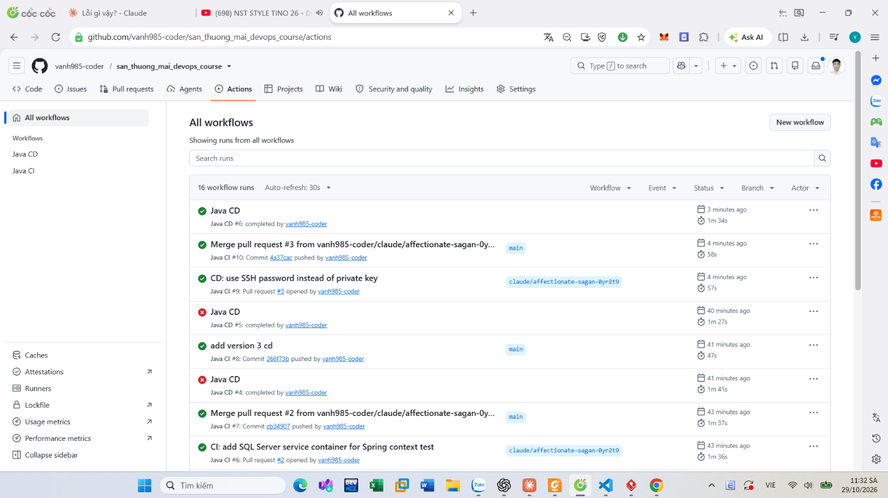

# CI/CD với GitHub Actions cho app Spring Boot (FASTSHOP)

> Ứng dụng web Java (FASTSHOP) đang chạy bằng Docker Compose trên server, nhưng mỗi lần cập nhật phải SSH vào và làm tay. Mục tiêu: chuẩn hóa một luồng CI/CD để push code lên GitHub là tự test, tự build image, tự deploy lên server và tự kiểm tra sau deploy.

## Kiến trúc luồng

```text
Dev push ──> GitHub ──> Java CI (build + test bằng Maven)
                              │ xanh
                              ▼
                        Java CD: build Docker image ──push──> GHCR (ghcr.io)
                              │                                   │
                              └──SSH──> Server ──docker compose pull──┘
                                          │
                                          └─ docker compose up -d app
                                          └─ docker compose ps + curl (health check)
```

## Đã làm

- **Workflow CI (`Java CI`)** chạy khi push hoặc mở pull request vào `dev`/`main`: cài Java 17 (Temurin, có cache Maven), chạy `./mvnw clean verify` để build và chạy test.
- **Workflow CD (`Java CD`)** chỉ chạy **sau khi CI xanh trên `main`** (`workflow_run` + điều kiện `conclusion == 'success'`), nên code test fail không bao giờ lên production.
- **Build image trên GitHub Actions và đẩy lên GHCR**, tag bằng commit SHA thay vì `latest`. Server không phải build, chỉ pull image.
- **Deploy qua SSH** bằng `appleboy/ssh-action`, private key nằm trong GitHub Secrets (`SSH_HOST`, `SSH_USER`, `SSH_PRIVATE_KEY`), public key trong `authorized_keys` của server.
- **Chỉ khởi động lại service `app`** (`--no-deps`), không đụng tới database.
- **Ghi tag image vào `.env`** trên server để các lệnh `docker compose ps/logs` gõ tay sau này vẫn chạy đúng, và không ghi đè các biến khác (mật khẩu DB).
- **Kiểm tra sau deploy ngay trong pipeline:** `set -e`, `docker compose ps`, `curl` có retry tới app. App không lên thì pipeline đỏ.

## Lựa chọn kỹ thuật

| Vấn đề | Cách chọn | Lý do |
|---|---|---|
| Build ở đâu | Build trên GitHub Actions, đẩy GHCR | Server không tốn CPU/RAM để build, cùng một image chạy được nhiều nơi |
| Tag image | Commit SHA | Biết chính xác bản nào đang chạy, rollback bằng cách chạy lại tag cũ |
| Thứ tự CI → CD | `workflow_run` | Hai workflow riêng chạy song song sẽ deploy cả bản test fail |
| "Pipeline xanh" có đủ không | Thêm health check cuối CD | Lệnh deploy chạy xong không chứng minh app phục vụ được request |

## Bài học

- **CI và CD là hai việc khác nhau.** CI trả lời "code có tốt không", CD trả lời "bản tốt đã lên server chưa". CD phải phụ thuộc kết quả CI.
- **GHCR mặc định private:** server phải `docker login ghcr.io` bằng token có quyền `read:packages`, nếu không `pull` báo `denied`.
- **`docker-compose.yml` phải dùng `image:` chứ không `build:`**, nếu không bước pull vô tác dụng.
- **Biến `export` trong phiên SSH của workflow mất khi phiên kết thúc**, nên phải lưu vào `.env` để vận hành tay sau đó.
- **Thực tế doanh nghiệp thường build image trên CI rồi đẩy lên registry**; build trực tiếp trên server chỉ hợp với dự án nhỏ một server.

## Kết quả

| Kiểm tra | Lệnh | Kết quả |
|---|---|---|
| Workflow CI | Tab Actions | Java CI #10 xanh trên commit `4a37cac` (58s) |
| Workflow CD | Tab Actions | Java CD #6 tự chạy sau CI và xanh (1m34s); CD #4, #5 fail ở bước SSH trước đó |
| Container | `docker compose ps` | _chưa cập nhật_ |
| Log app | `docker compose logs --tail=30 app` | _chưa cập nhật_ |



**Sự cố đã gặp:** CI fail vì test Spring context cần database, sửa bằng service container SQL Server trong `ci.yml`. CD fail ở bước SSH, đang tạm dùng mật khẩu, cần chuyển lại SSH key.
| Response | `curl -i http://localhost:18096/` | _chưa cập nhật_ |

## Còn dang dở

Ảnh minh chứng (repo, file workflow, Secrets, log Actions xanh, `docker compose ps/logs`, `curl`), điền kết quả thật vào `bai1-cicd-summary.txt`, Bài 2 (checklist sau deploy), Bài 3 (script health-check), Bài 4–5 (Kubernetes).

## Hồ sơ

| File / thư mục | Nội dung |
|---|---|
| [BÀI TẬP VỀ NHÀ_CICD_K8S.pdf](<BÀI TẬP VỀ NHÀ_CICD_K8S.pdf>) | Đề bài 5 bài CI/CD và Kubernetes |
| [bai1-cicd-summary.txt](bai1-cicd-summary.txt) | Tóm tắt Bài 1 |
| [bai2-post-deploy-check.txt](bai2-post-deploy-check.txt) | Checklist kiểm tra sau deploy |
| [bai3-healthcheck-note.txt](bai3-healthcheck-note.txt) | Ghi chú script health-check |
| [devops-cicd-demo/](devops-cicd-demo/) | Repo mẫu nginx dùng để thử luồng ban đầu, kèm `health-check.sh` |
