# Thực hành các câu lệnh Linux cơ bản cho Developer

> Bài tập Buổi 7 – Câu lệnh Linux cho Developer. Thực hành trên Ubuntu chạy trong VMware Workstation, gồm 7 bài: thao tác file/thư mục, Git, đọc log, tìm kiếm, kiểm tra công cụ, thông tin hệ thống và mạng.

📄 Đề bài đầy đủ xem tại [DE-BAI.md](DE-BAI.md).

## Môi trường thực hành

| Thành phần | Chi tiết |
|---|---|
| Hệ điều hành | Ubuntu (máy ảo VM_Ubuntu) |
| Công cụ ảo hóa | VMware Workstation |
| Shell | Bash |
| Công cụ dùng | Git, nano, vim, curl |

## Kỹ năng thể hiện

- **Làm việc với terminal:** tạo, di chuyển, đổi tên, sao chép, xóa file và thư mục (`mkdir`, `cd`, `touch`, `ls`, `mv`, `cp`, `rm`).
- **Git:** quy trình `add` → `commit` → `push` lên GitHub.
- **Đọc và phân tích log:** `cat`, `head`, `tail`, `grep` để lọc dòng lỗi (ERROR) trong `app.log`.
- **Tìm kiếm file và nội dung:** `find`, `grep -r`, `grep -rl`.
- **Kiểm tra môi trường dev:** kiểm tra phiên bản Git, Vim, curl.
- **Quản trị hệ thống cơ bản:** xem hostname, IP, người dùng, RAM, kernel.
- **Chẩn đoán mạng:** `ping`, `curl`, `ss` để kiểm tra kết nối và các cổng đang lắng nghe.

## Nội dung chi tiết

### Bài 1 – Tạo cấu trúc thư mục dự án
Dựng cấu trúc dự án mẫu `dev-practice/` gồm `backend/`, `frontend/`, `scripts/`, tạo các file cấu hình, log và script bên trong.

- **Lệnh:** `mkdir`, `cd`, `touch`, `ls`, `rm`
- **Kết quả:** tạo file `deploy.sh` ở sai chỗ, xóa đi rồi tạo lại đúng trong `scripts/`.

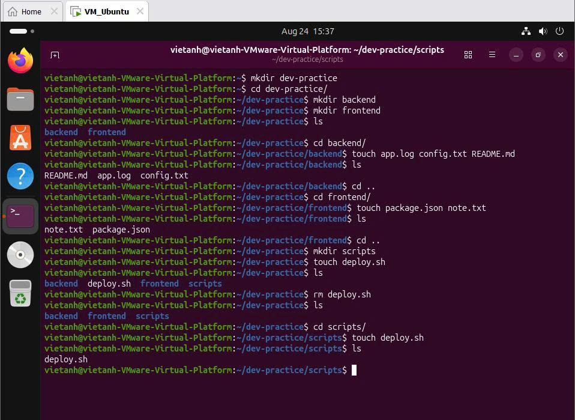

### Bài 2 – Quản lý file và đẩy code lên GitHub
Đổi tên, sao chép, xóa file trong `backend/`, sau đó commit và push lên GitHub.

- **Lệnh:** `mv`, `cp`, `rm`, `git add`, `git commit`, `git status`, `git push`
- **Kết quả:** push thành công lên nhánh `main` của repo `Linux_Practice`.

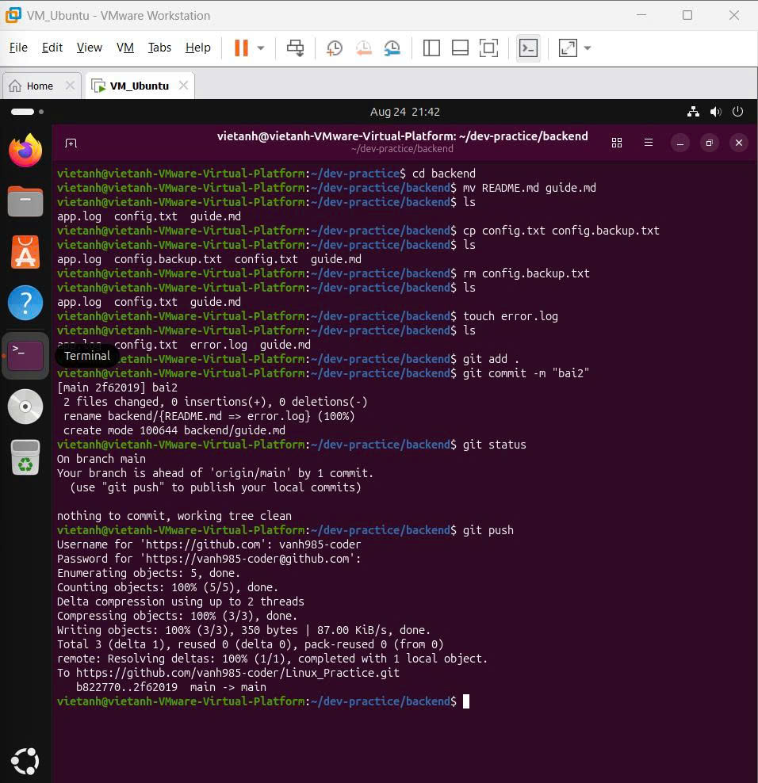

### Bài 3 – Đọc và lọc log
Ghi nội dung vào `app.log` bằng nano, rồi đọc và lọc log.

- **Lệnh:** `nano`, `cat`, `head -n`, `tail -n`, `grep`
- **Kết quả:** lọc ra 2 dòng `ERROR` (lỗi kết nối database và timeout) trong 5 dòng log, sau đó commit và push.

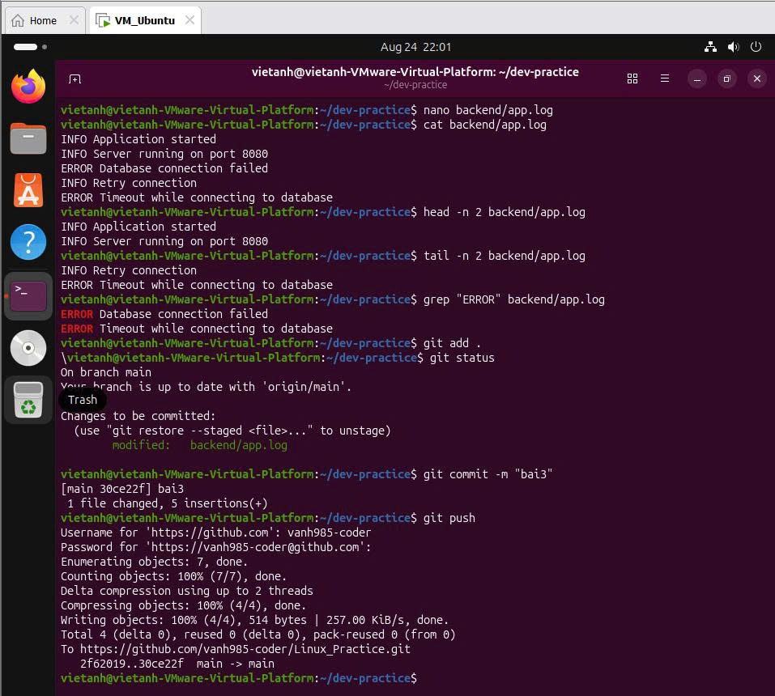

### Bài 4 – Tìm kiếm file và nội dung
Tìm file theo tên và tìm chuỗi `port` trong cả dự án.

- **Lệnh:** `find . -name`, `grep -r`, `grep -rl`
- **Kết quả:** tìm được toàn bộ file `*.txt`, `*.log`, `package.json`. Chạy `grep "port" ./` báo lỗi vì `./` là thư mục, nên dùng `grep -r` để tìm đệ quy. `grep -rl` chỉ liệt kê tên file chứa chuỗi.

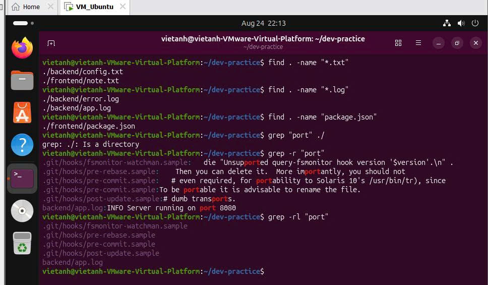

### Bài 5 – Kiểm tra phiên bản công cụ
Kiểm tra các công cụ cần cho môi trường phát triển.

- **Lệnh:** `git --version`, `vim --version`, `curl --version`
- **Kết quả:** Git 2.53.0, Vim 9.1, curl 8.18.0. Gõ nhầm `curl version` bị báo `Could not resolve host`, vì curl hiểu `version` là tên website. Đúng cú pháp là `curl --version`.

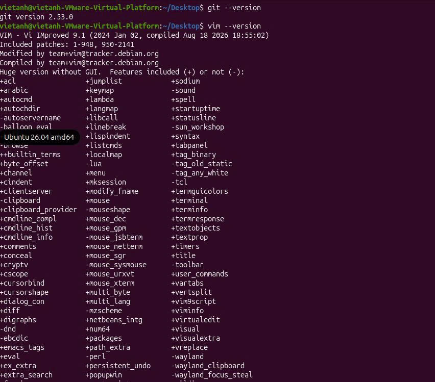
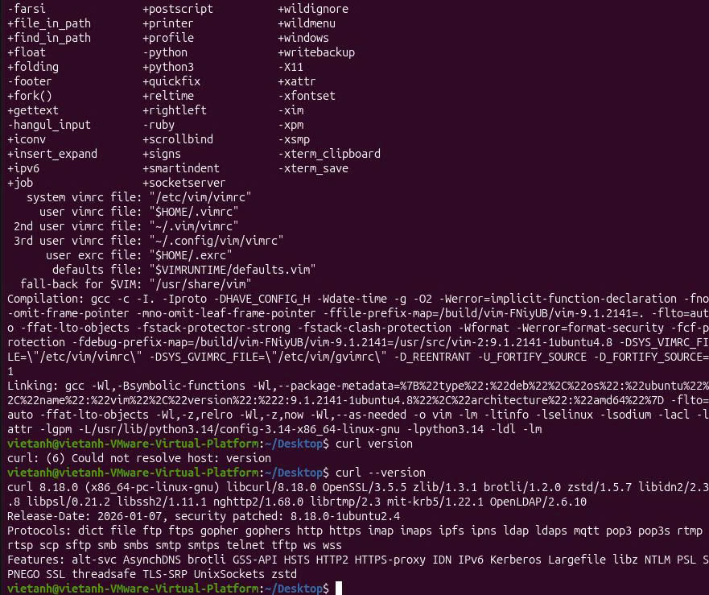

### Bài 6 – Thông tin hệ thống
Xem thông tin máy và người dùng.

- **Lệnh:** `hostname`, `ip address show`, `whoami`, `free -h`, `uname -a`
- **Kết quả:** Đọc được địa chỉ IP trong mạng nội bộ (card mạng `ens33`), dung lượng RAM và phiên bản kernel. Gõ `ipconfig` và `username` đều báo lỗi vì đó là lệnh của Windows hoặc không tồn tại trên Linux. Tương đương trên Linux là `ip address show` và `whoami`.

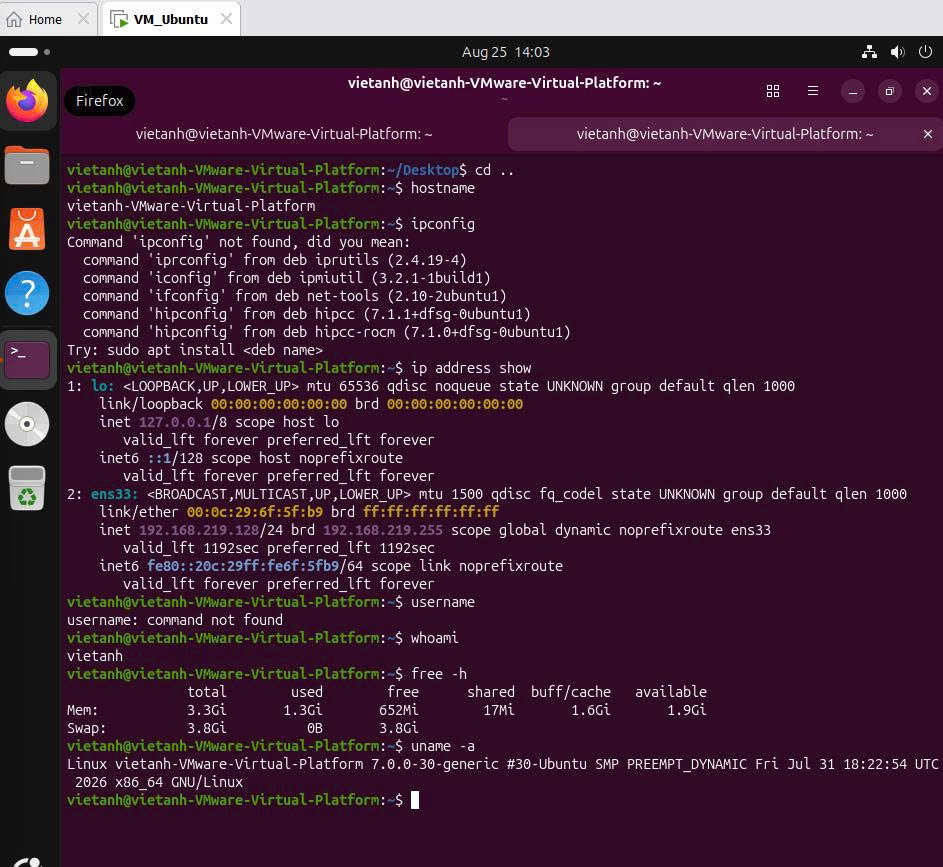

### Bài 7 – Kiểm tra mạng
Kiểm tra kết nối Internet và các dịch vụ đang chạy.

- **Lệnh:** `ping -c 5`, `curl`, `ss -tuln`
- **Kết quả:** ping `google.com` 5 gói, 0% mất gói. `curl https://example.com` trả về HTML của trang. `ss -tuln` liệt kê các cổng TCP/UDP đang lắng nghe.

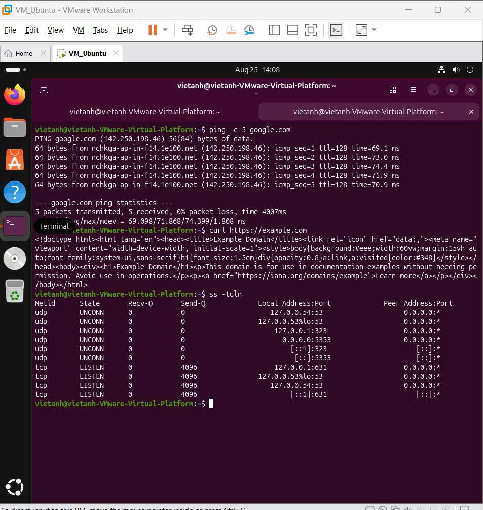

## Lỗi đã gặp và cách giải quyết

### 1. Tạo file sai vị trí (Bài 1)
- **Hiện tượng:** `deploy.sh` được tạo ở thư mục `dev-practice/` thay vì `dev-practice/scripts/`. Dùng `ls` thấy file nằm cùng cấp với `backend`, `frontend`, `scripts`.
- **Cách giải quyết:** xóa file sai chỗ bằng `rm deploy.sh`, chuyển vào thư mục đúng bằng `cd scripts/`, rồi tạo lại bằng `touch deploy.sh`. Dùng `ls` kiểm tra lại thì `deploy.sh` đã nằm trong `scripts/`. (Xem ảnh Bài 1.)

### 2. `grep` báo "Is a directory" (Bài 4)
- **Lệnh gây lỗi:** `grep "port" ./`
- **Thông báo lỗi:** `grep: ./: Is a directory`
- **Nguyên nhân:** `grep` mặc định chỉ tìm trong file, không tìm trong thư mục.
- **Cách giải quyết:** thêm tùy chọn `-r` (recursive) để tìm đệ quy trong toàn bộ thư mục: `grep -r "port"`. Muốn chỉ xem tên file có chứa từ khóa thì dùng `grep -rl "port"`. (Xem ảnh Bài 4.)

### 3. `curl` báo "Could not resolve host" (Bài 5)
- **Lệnh gây lỗi:** `curl version`
- **Thông báo lỗi:** `curl: (6) Could not resolve host: version`
- **Nguyên nhân:** thiếu hai dấu gạch ngang nên `curl` hiểu `version` là tên website cần truy cập và đi tìm host này.
- **Cách giải quyết:** dùng đúng tùy chọn `curl --version`. (Xem ảnh Bài 5.)

### 4. `ipconfig` và `username` không chạy được (Bài 6)
- **Lệnh gây lỗi:** `ipconfig`, `username`
- **Thông báo lỗi:** `Command 'ipconfig' not found`, `username: command not found`
- **Nguyên nhân:** `ipconfig` là lệnh của Windows, còn `username` không phải lệnh trên Linux.
- **Cách giải quyết:** dùng lệnh tương đương trên Linux: `ip address show` để xem địa chỉ IP, `whoami` để xem tên user hiện tại. (Xem ảnh Bài 6.)

### 5. Lỗi DNS: không ping được tên miền (tình huống tự tạo)
Mình chủ động sửa sai địa chỉ `nameserver` trong `/etc/resolv.conf` để tạo tình huống lỗi DNS, rồi chẩn đoán và khắc phục.

- **Hiện tượng:** `ping google.com` báo `Temporary failure in name resolution`, nhưng `ping 8.8.8.8` vẫn thành công. Vậy kết nối mạng bình thường, lỗi nằm ở khâu phân giải tên miền (DNS).

  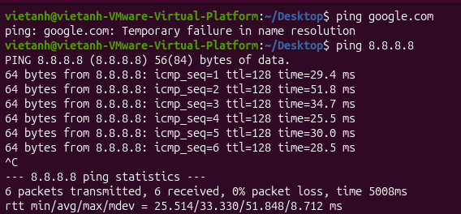

- **Nguyên nhân:** kiểm tra bằng `cat /etc/resolv.conf` thấy dòng `nameserver 127.0.0.5`. Địa chỉ đúng phải là `127.0.0.53`, là dịch vụ `systemd-resolved` chạy ngay trên máy. Chương trình gửi câu hỏi "tên miền này có IP là gì" tới địa chỉ này, sau đó `systemd-resolved` chuyển tiếp lên DNS server bên ngoài. Địa chỉ `127.0.0.5` không có dịch vụ nào lắng nghe nên không ai trả lời.

  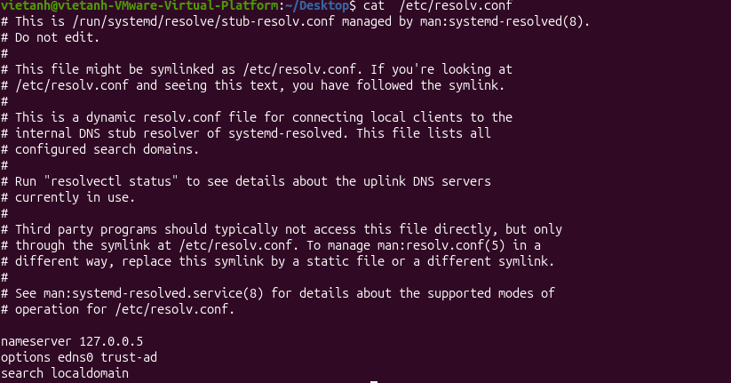

- **Cách giải quyết:** mở file bằng `sudo nano /etc/resolv.conf`, đổi `nameserver` thành `127.0.0.53` để chương trình hỏi `systemd-resolved` như bình thường.
- **Kết quả:** `ping google.com` phân giải được tên miền ra IP `74.125.200.113` và ping thành công.

  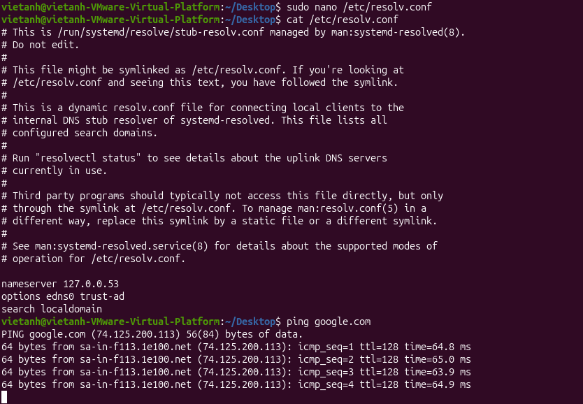

- **Luồng phân giải tên miền:** trong `/etc/systemd/resolved.conf` của máy mình có dòng `DNS=8.8.8.8`, nên `systemd-resolved` hỏi DNS server `8.8.8.8` của Google. Nếu không đặt dòng này, nó sẽ dùng DNS server từ cấu hình mạng.

  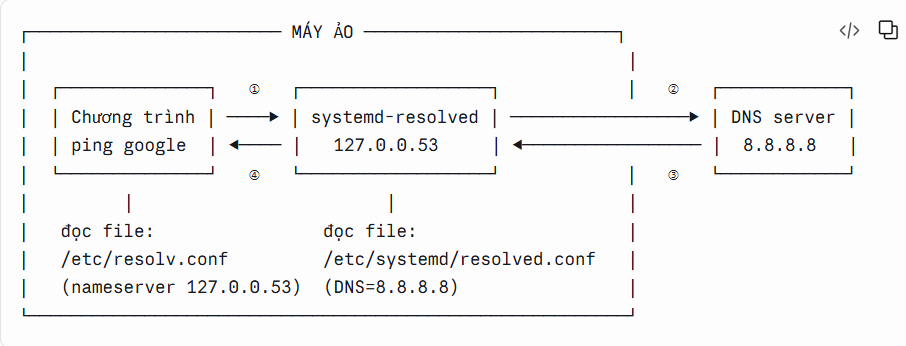

  1. Chương trình `ping` đọc `/etc/resolv.conf`, thấy `nameserver 127.0.0.53` nên gửi câu hỏi tới `systemd-resolved`.
  2. `systemd-resolved` đọc `/etc/systemd/resolved.conf` (`DNS=8.8.8.8`) và chuyển câu hỏi lên DNS server `8.8.8.8`.
  3. DNS server trả về địa chỉ IP của tên miền.
  4. `systemd-resolved` trả IP về cho `ping`, và `ping` gửi gói tin tới IP đó.

  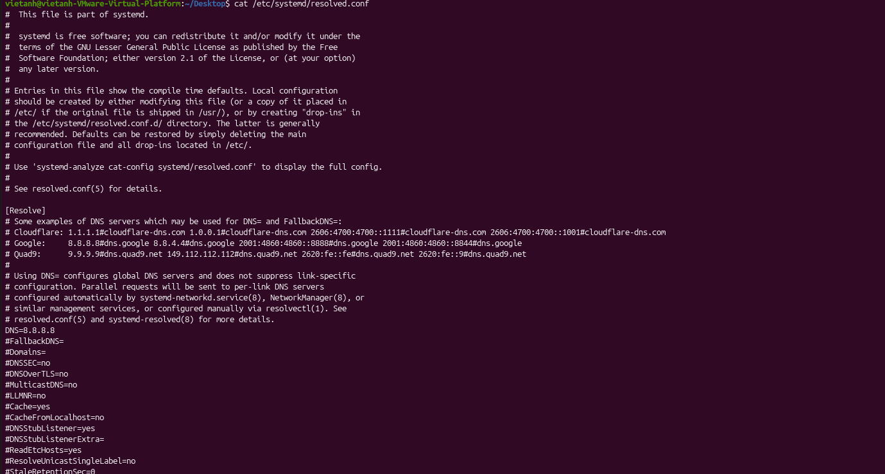

- **Sau khi khởi động lại máy:** `/etc/resolv.conf` vẫn là `nameserver 127.0.0.53`, hệ thống chạy bình thường.

  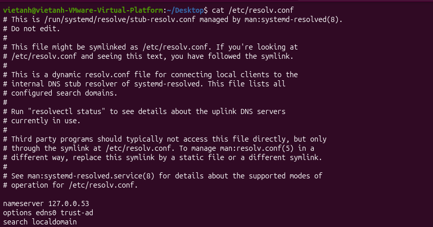

## Bài học rút ra

- **Đọc kỹ thông báo lỗi:** Ki gặp lỗi, đọc xem hệ thống báo lỗi gì để biết hướng giải quyết.
- **Xem lỗi theo sơ đồ hệ thống:** Nắm sơ đồ hoạt động của hệ thống (ví dụ luồng phân giải DNS) để xác định hệ thống "chết" ở khâu nào, từ đó tìm ra hướng sửa.
- **Hướng học tiếp:** Sau khi có nền tảng Linux, mình sẽ học tiếp Docker.

## Liên hệ

- GitHub: [vanh985-coder](https://github.com/vanh985-coder)
- Email: vietanhhpts123@gmail.com
