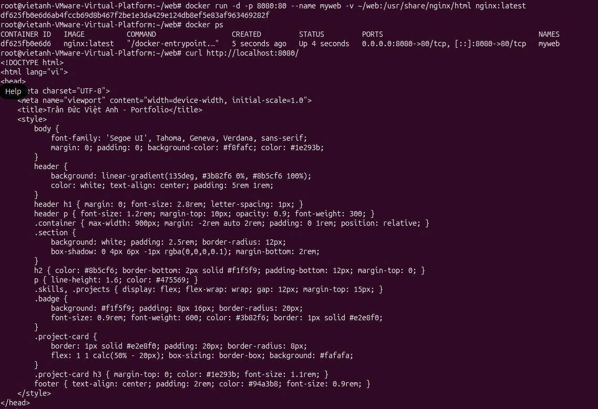
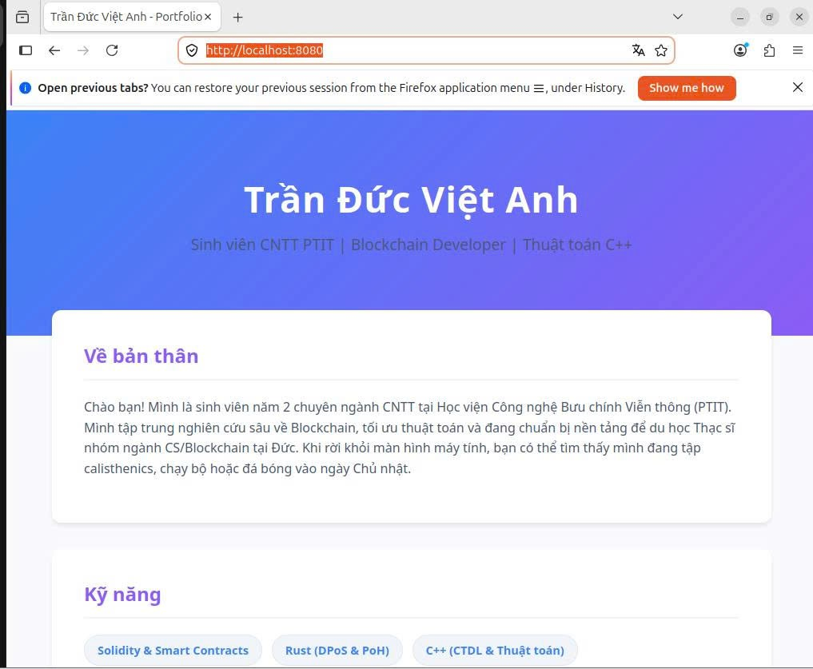
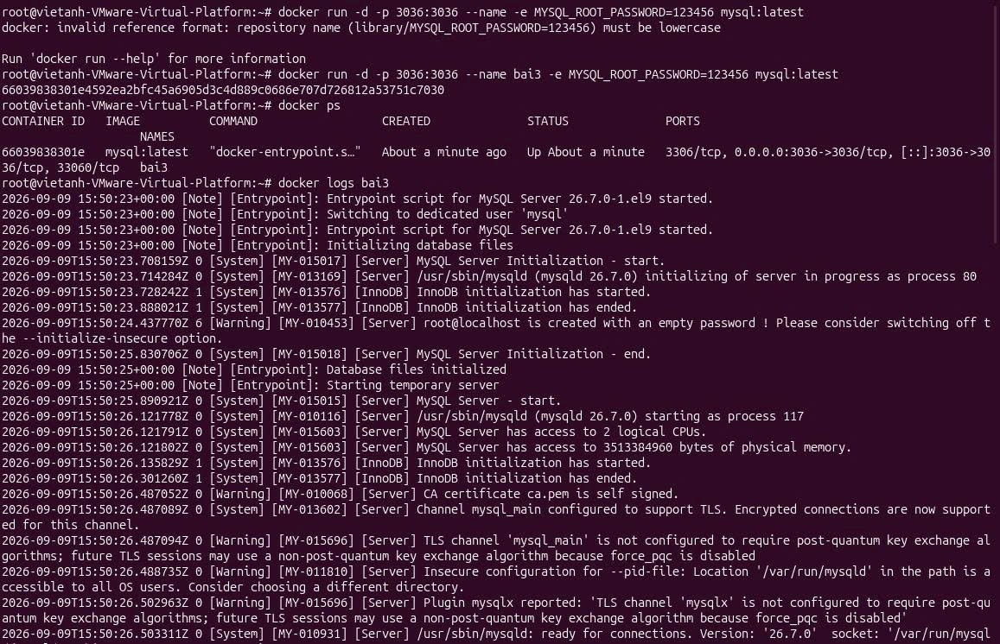
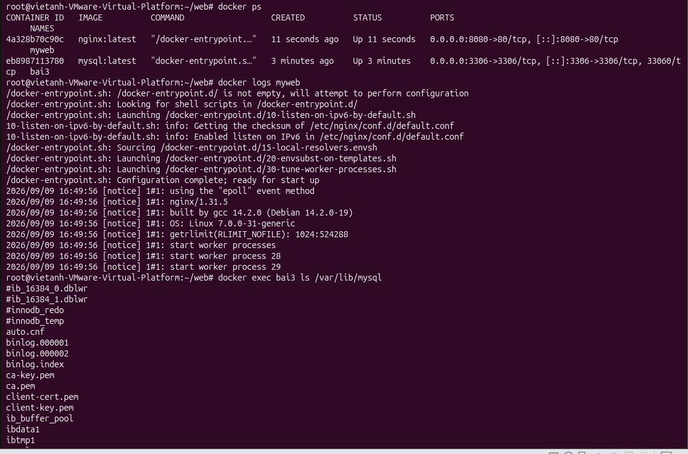
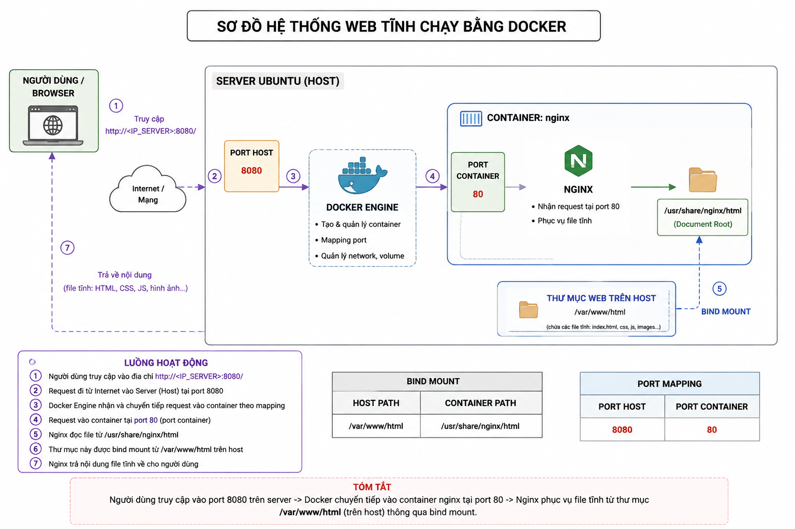
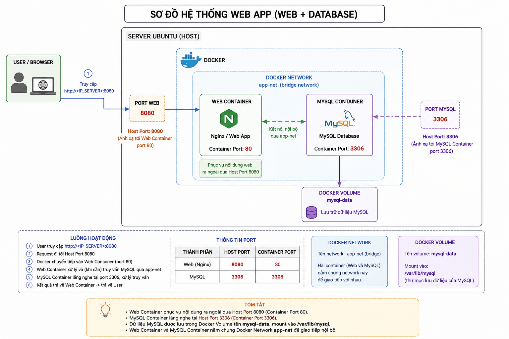
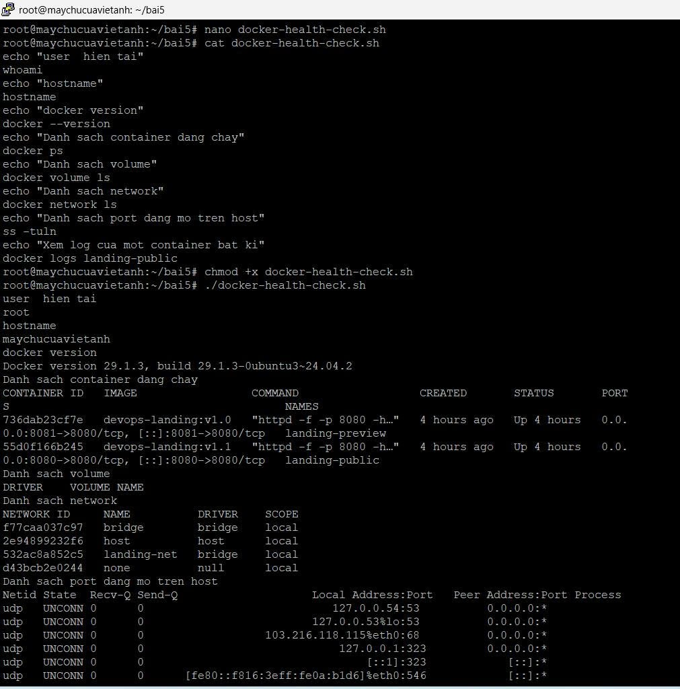
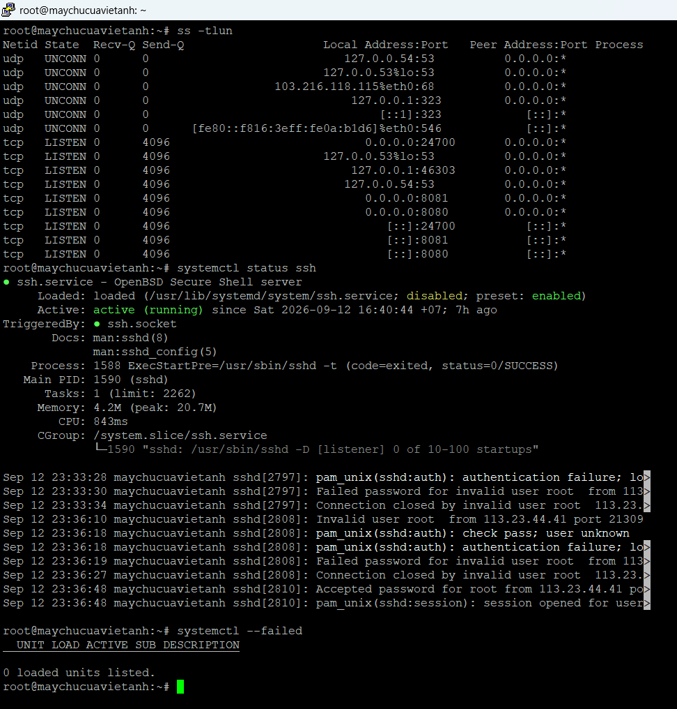
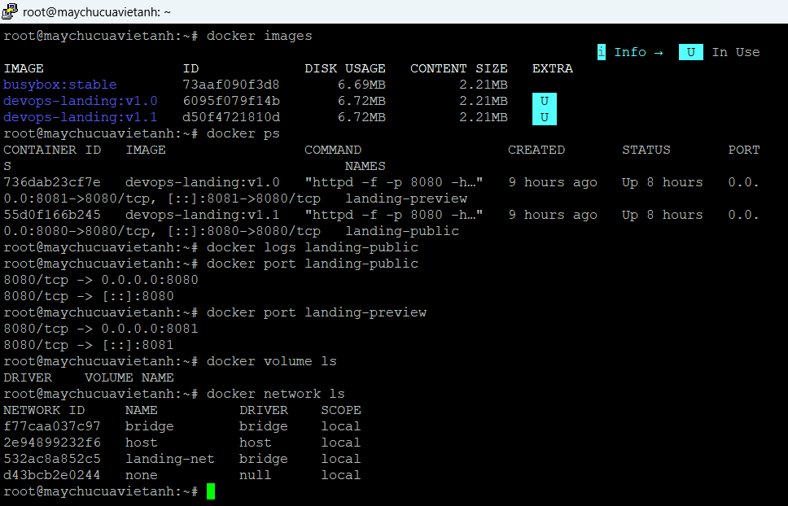

# Docker thực chiến với web app trên Ubuntu 

> Chín bài thực hành Docker: dựng web tĩnh bằng nginx, sửa nội dung bằng bind mount, chạy MySQL, giữ dữ liệu bằng volume, kiểm tra container như một service thật, vẽ sơ đồ hệ thống, viết script kiểm tra và tiếp nhận một server đang chạy web app. Mỗi bài có lệnh đã chạy và ảnh kết quả thực tế, kể cả những chỗ mình làm sai.

Quay lại [README tổng](../README.md).

## Tóm tắt

| | |
|---|---|
| Môi trường | Bài 1–5: Ubuntu trong VMware (hostname `vietanh-VMware-Virtual-Platform`). Bài 8–9: VPS Ubuntu 24.04 (hostname `maychucuavietanh`) |
| Công cụ | Docker 29.1.3, nginx, MySQL, Bash, `ss`, `systemctl` |
| Đề bài | [DE-BAI.md](DE-BAI.md) · bản gốc [Đề bài.pdf](<Đề bài.pdf>) (ai5.vn, bài tập về nhà buổi 11) |
| Báo cáo đầy đủ | [Bao_cao.pdf](Bao_cao.pdf) · [Bao_cao.docx](Bao_cao.docx) |
| Kết luận kỹ thuật | [summary-buoi11.txt](summary-buoi11.txt) |

## Đã làm

| Bài | Yêu cầu | Lệnh chính | Kết quả |
|---|---|---|---|
| 1 | Dựng web tĩnh bằng nginx container, không cài nginx lên host | `docker run -d -p 8080:80 --name myweb -v ~/web:/usr/share/nginx/html nginx:latest`, `docker ps`, `curl` | Web trả về đúng trang giới thiệu qua `localhost:8080` |
| 2 | Sửa web mà không tạo lại container | Bind mount `~/web`, sửa `index.html` trên host | Tiêu đề và nội dung trang đổi ngay sau khi sửa file, container không bị tạo lại |
| 3 | Chạy MySQL như một database service | `docker run -e MYSQL_ROOT_PASSWORD=... mysql:latest`, `docker logs`, `ss -tuln` | Log MySQL báo `ready for connections` |
| 4 | Giữ dữ liệu khi xóa container | `docker volume create mysql_data`, `docker volume ls`, chạy lại MySQL có `-v` | Đã tạo volume, có ghi chú giải thích vì sao database cần volume (xem phần Còn dang dở về lỗi đường dẫn) |
| 5 | Kiểm tra container như service thật | `docker ps`, `docker logs`, `docker exec ... ls`, `ss -tuln` | Xem được container, log, thư mục bên trong và cổng đang mở trên host |
| 6 | Sơ đồ web tĩnh bằng Docker | | Sơ đồ có browser, host, Docker Engine, nginx, bind mount, cổng 8080 và 80, luồng request đánh số 1–7 |
| 7 | Sơ đồ web + database | | Sơ đồ có hai container, volume, network, cổng web và cổng MySQL |
| 8 | Script `docker-health-check.sh` | `chmod +x`, `./docker-health-check.sh` | Script in ra user, hostname, Docker version, container, volume, network, cổng mở và log container |
| 9 | Tiếp nhận và kiểm tra server đang chạy web app | `whoami`, `uptime`, `ip a`, `df -h`, `ss -tlun`, `systemctl status ssh`, `systemctl --failed`, `docker inspect`, `curl` | 5 nhóm kiểm tra và file `summary-buoi11.txt` |

### Bằng chứng chính

**Bài 1 – nginx container, `docker ps`, `curl`**

**Bài 2 – bind mount: trước và sau khi sửa file trên host**

| Trước | Sau |
|---|---|
|  |  |

**Bài 3 – chạy MySQL, xem log**

**Bài 5 – kiểm tra container: `docker ps`, `docker logs`, `docker exec`**

**Bài 6 và 7 – sơ đồ hệ thống**

**Bài 8 – script kiểm tra Docker, chạy trên VPS**

**Bài 9 – tiếp nhận server: cổng mở, SSH, service lỗi, inventory Docker**

## Kết quả kiểm tra server ở Bài 9

| Hạng mục | Kết quả |
|---|---|
| Hostname / IP | `maychucuavietanh` / `103.216.118.115` |
| Container đang chạy | 2: `landing-public` (cổng 8080, image `devops-landing:v1.1`) và `landing-preview` (cổng 8081, image `devops-landing:v1.0`) |
| Database | Không có container database, không có cổng database |
| Volume | Không có volume nào; `docker inspect -f '{{json .Mounts}}' landing-public` trả về `[]` nên dữ liệu web nằm trong image, không nằm trên host |
| Service lỗi | `systemctl --failed`: 0 unit |
| SSH | `ssh.service` đang chạy, được kích hoạt bởi `ssh.socket` |

**3 rủi ro kỹ thuật đã ghi nhận:**

- Không có database và không có volume để lưu dữ liệu, nên dữ liệu người dùng sẽ mất khi container bị xóa hoặc tạo lại.
- Cổng 8081 (bản preview) đang mở trên `0.0.0.0`, ai cũng truy cập được, trong khi bản preview không được phép công khai.
- SSH cho phép đăng nhập `root` bằng mật khẩu và đã có nhiều lần thử mật khẩu sai từ IP lạ trong log, nên server có nguy cơ bị dò mật khẩu và chiếm quyền.

**3 việc sẽ làm nếu được vận hành server này:**

- Tạo volume (hoặc database) và mount vào container, để server có nơi lưu dữ liệu bền vững.
- Dùng tường lửa (UFW) chỉ cho phép một số IP truy cập bản preview và database; hoặc đưa server lên tên miền và dùng nginx làm reverse proxy để điều phối request tới đúng cổng, tránh để lộ các dịch vụ nội bộ.
- Tắt đăng nhập `root` bằng mật khẩu, chuyển sang SSH key với user thường dùng `sudo`, và cài Fail2ban để tự chặn IP dò mật khẩu.

Trong log SSH ở ảnh Bài 9 có các dòng `Failed password for invalid user root` từ một IP lạ. Phần điều tra và chặn truy cập này được làm riêng ở [Bài 4 – Điều tra SSH](<../Bộ 5 bài tập linux/Bai_04_Dieu_tra_SSH/>) trong bộ Linux nâng cao.

## Còn dang dở và lỗi mình tự phát hiện khi rà lại

Mình ghi ra để người đọc biết mình hiểu chỗ nào đã sai, thay vì để họ tự phát hiện.

- **Bài 3 – gõ nhầm cổng.** Lệnh `-p 3036:3036` thay vì `-p 3306:3306`. MySQL lắng nghe cổng 3306 bên trong container nên cổng 3036 trên host không dẫn tới MySQL. Ở Bài 5, container chạy lại với `3306:3306` và `ss -tuln` hiển thị đúng cổng 3306.
- **Bài 4 – sai chữ hoa chữ thường trong đường dẫn volume.** Lệnh dùng `-v mysql_data:/var/lib/MySQL`, trong khi thư mục dữ liệu của MySQL là `/var/lib/mysql`. Linux phân biệt hoa thường, nên nhiều khả năng `mysql_data` chưa chứa dữ liệu thật. Cần chạy lại với đúng đường dẫn rồi kiểm chứng bằng `docker inspect` và một lần xóa/tạo lại container.
- **Bài 6, 7 – sơ đồ và lệnh thực tế chưa khớp tên.** Sơ đồ Bài 6 ghi thư mục host là `/var/www/html` trong khi lệnh thực tế mount `~/web`. Sơ đồ Bài 7 ghi network `app-net` và volume `mysql-data`, nhưng các ảnh chưa cho thấy network này được tạo, và volume thực tế tên `mysql_data`. Sơ đồ đang mô tả kiến trúc mục tiêu hơn là hiện trạng.
- **Bài 1–5 chạy trên VM cục bộ**, chỉ Bài 8–9 chạy trên VPS được cấp..

## Bài học rút ra

- Container đã dừng vẫn còn tên, nên `docker run --name` lần hai báo `Conflict`; phải `docker rm` rồi mới chạy lại.
- Tham số `--name` cần có giá trị; thiếu giá trị thì Docker hiểu `-e` là tên image và báo lỗi `must be lowercase`.
- Bind mount phù hợp để sửa nội dung nhanh, còn dữ liệu database nên dùng volume có tên, và phải kiểm chứng bằng `docker inspect` thay vì tin vào việc lệnh chạy không báo lỗi.
- `docker ps` cho biết cổng đã map, nhưng muốn biết cổng có thực sự mở trên host thì cần `ss -tuln`.
- Mật khẩu `MYSQL_ROOT_PASSWORD` đặt trực tiếp trên dòng lệnh chỉ nên dùng khi thực hành; môi trường thật cần secret hoặc file `.env` không đưa lên Git.

## Hồ sơ

| File / thư mục | Nội dung |
|---|---|
| [Đề bài.pdf](<Đề bài.pdf>) | Đề bài 9 bài của khóa học |
| [Bao_cao.pdf](Bao_cao.pdf), [Bao_cao.docx](Bao_cao.docx) | Báo cáo đầy đủ, mỗi bài kèm ảnh chụp terminal |
| [summary-buoi11.txt](summary-buoi11.txt) | Kết luận kỹ thuật Bài 9 |
| [images/](images/) | Ảnh minh chứng được trích từ báo cáo |
