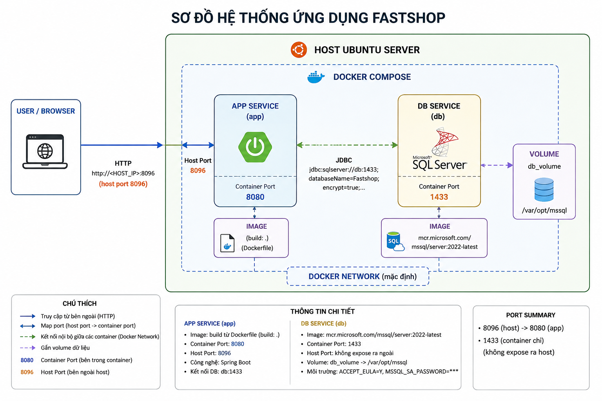
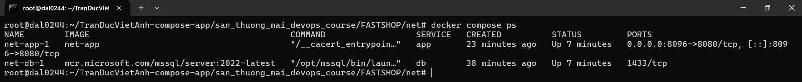
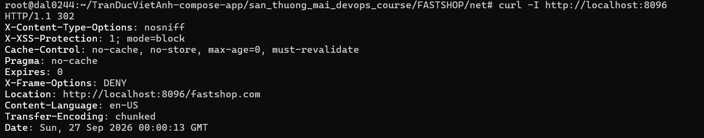
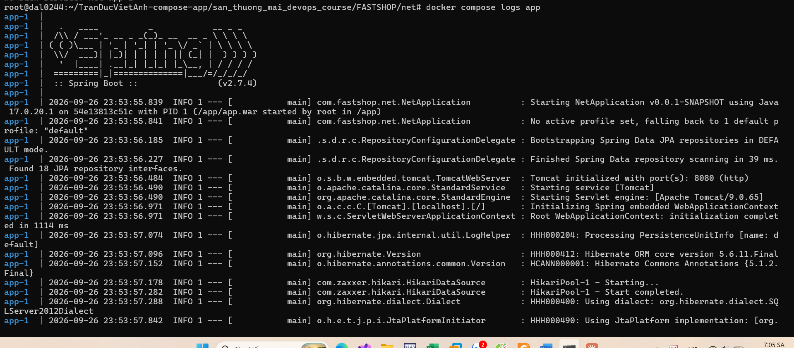
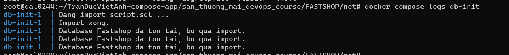

# Docker Compose thực chiến – Ứng dụng Spring Boot + SQL Server

> Đóng gói một web app thương mại điện tử (Java 17, Spring Boot, SQL Server) bằng Dockerfile và Docker Compose, rồi chạy trên Ubuntu server. Source code tải từ GitHub, không phải mình viết; phần mình làm là Docker hóa, nối các service, kiểm tra log, port, volume và vẽ sơ đồ hệ thống.

## Đã làm

- **Dockerfile multi-stage:** stage `build` dùng `maven:3.9-eclipse-temurin-17` để build ra file `.war`, stage chạy dùng `eclipse-temurin:17-jre`. Image chạy không chứa Maven và source. Build tay bằng `docker build -t fastshop-app .`, còn khi chạy bằng Compose thì image được build lại với tên `net-app`.
- **Docker Compose 3 service** dựng bằng một lệnh `docker compose up -d --build`:

  | Service | Vai trò | Cổng |
  |---|---|---|
  | `app` | Spring Boot, build từ Dockerfile | `8096` (host) → `8080` (container) |
  | `db` | SQL Server 2022, lưu dữ liệu vào volume `db_volume` | `1433`, chỉ trong network Docker, không mở ra host |
  | `db-init` | Container chạy một lần để import `script.sql` tạo database | không có |

- **Thứ tự khởi động có điều kiện:** `db` có `healthcheck` (chạy `sqlcmd SELECT 1`), `db-init` chờ `db` ở trạng thái `service_healthy`, `app` chờ `db-init` ở trạng thái `service_completed_successfully`.
- **Cấu hình qua biến môi trường:** chuỗi kết nối JDBC, mật khẩu DB và cổng truyền vào `app` bằng `environment`, không sửa trong source.
- **Restart policy:** `app` dùng `unless-stopped`, `db-init` dùng `"no"` vì chỉ cần chạy một lần.
- **Kiểm tra sau khi chạy:** `docker compose ps`, `docker compose logs` cho từng service, `ss -tuln`, `curl -I` vào cổng app.



## Cấu hình chính

Trích từ `docker-compose.yml` (mật khẩu đã thay bằng biến):

```yaml
services:
  db:
    image: mcr.microsoft.com/mssql/server:2022-latest
    environment:
      ACCEPT_EULA: "Y"
      MSSQL_SA_PASSWORD: "${DB_PASSWORD}"
    volumes:
      - "db_volume:/var/opt/mssql"
    healthcheck:
      test: ["CMD-SHELL", "/opt/mssql-tools18/bin/sqlcmd -S localhost -U sa -P \"$$MSSQL_SA_PASSWORD\" -C -Q 'SELECT 1' || exit 1"]
      interval: 10s
      timeout: 5s
      retries: 10
      start_period: 20s
  app:
    build: .
    ports:
      - "8096:8080"
    environment:
      SERVER_PORT: "8080"
      SPRING_DATASOURCE_URL: "jdbc:sqlserver://db:1433;databaseName=Fastshop;encrypt=true;trustServerCertificate=true;sslProtocol=TLSv1.2"
    depends_on:
      db-init:
        condition: service_completed_successfully
    restart: unless-stopped
  db-init:
    image: mcr.microsoft.com/mssql/server:2022-latest
    volumes:
      - "./database/script.sql:/scripts/script.sql:ro"
      - "./docker/init-db.sh:/scripts/init-db.sh:ro"
    entrypoint: ["bash", "/scripts/init-db.sh"]
    depends_on:
      db:
        condition: service_healthy
    restart: "no"
volumes:
  db_volume:
```

## Kết quả

`docker compose ps` cho thấy `app` và `db` đang `Up`, `db-init` không còn trong danh sách vì đã chạy xong (đúng thiết kế). Cổng `1433` của DB chỉ hiện `1433/tcp`, không có ánh xạ ra host.



`curl -I http://localhost:8096` trả `HTTP 302` chuyển hướng tới `/fastshop.com`, và log app cho thấy Spring Boot 2.7.4 khởi động, Tomcat nghe cổng `8080`, kết nối DB qua HikariCP.

| | |
|---|---|
|  |  |

Log `db-init` cho thấy script chỉ import khi chưa có database và bỏ qua ở các lần chạy sau:



## Bài học

- **App tắt ngay khi chưa có DB.** Lần đầu app khởi động xong rồi thoát vì database chưa tồn tại. Cách sửa là thêm `db-init` và đặt `depends_on` theo chuỗi `db` → `db-init` → `app`.
- **`depends_on` chỉ chờ container khởi động, không chờ dịch vụ sẵn sàng.** Vì vậy cần `healthcheck` cho `db` và dùng `condition: service_healthy` thay vì chỉ liệt kê tên service.
- **Lỗi thụt dòng YAML** xảy ra nhiều lần khi viết `docker-compose.yml`; phải kiểm tra lại cấu trúc trước khi chạy.
- **Chỉ publish cổng cần thiết.** Chỉ `8096` mở ra host, DB giao tiếp với app qua tên service `db` trong network mặc định của Compose.

## Còn dang dở

- **Trang chủ trả lỗi 500 khi mở bằng trình duyệt.** `curl` thấy `302`, nhưng trang `/fastshop.com` hiện Whitelabel Error Page (`status=500`). Mình chưa điều tra nguyên nhân bằng `docker compose logs app` ngay lúc lỗi. Các biến Google, Facebook và mail đang để giá trị `dummy`.
- **Mật khẩu DB đang viết thẳng trong `docker-compose.yml`.** Hướng sửa: đưa vào file `.env` (đã có `.env.example`) và tham chiếu bằng `${DB_PASSWORD}`.
- **Chưa kiểm tra volume sau khi xóa container**, tức là chưa chứng minh dữ liệu còn nguyên sau `docker compose down` rồi `up` lại.
- **Image `db-init` dùng tag `latest`** (`2022-latest`), chưa ghim phiên bản cụ thể.

## Hồ sơ

| File / thư mục | Nội dung |
|---|---|
| [Hoàn thành bài tập thực hành.docx](<Hoàn thành bài tập thực hành.docx>) | Bài làm đầy đủ theo 9 bước, kèm 26 ảnh chụp màn hình |
| [Bài tập thực hành docker-compose.pdf](<Bài tập thực hành docker-compose.pdf>) | Đề bài |
| [summary-TranDucVietAnh.txt](summary-TranDucVietAnh.txt) | Báo cáo kỹ thuật ngắn theo mẫu của đề |
| [Minh_chung/](Minh_chung/) | Ảnh chọn lọc dùng trong README này |
