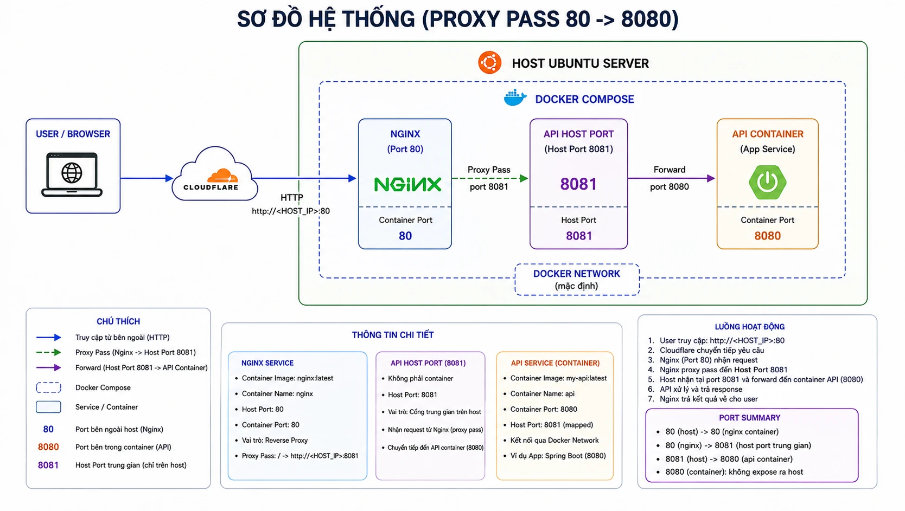
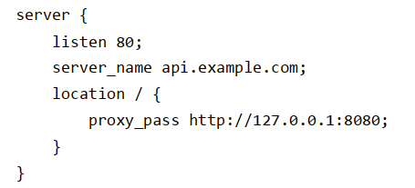
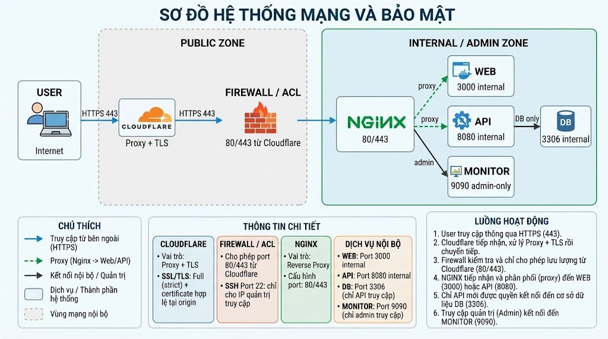

# Tổng hợp kiến thức – Web, Cloudflare, Nginx, Docker, Dockerfile

## Tổng quan

| Hạng mục          | Nội dung                                                                                                                                                                  |
| ----------------- | ------------------------------------------------------------------------------------------------------------------------------------------------------------------------- |
| Phạm vi           | Buổi 1–9: Web foundation, Server, Cloudflare, Nginx, Docker, Dockerfile                                                                                                   |
| Cấu trúc          | Phần I: 50 câu trắc nghiệm (50 điểm) · Phần II: 3 câu tự luận (50 điểm)                                                                                                   |
| Thời gian         | 150 phút                                                                                                                                                                  |
| Mã cá nhân        | `N = 43` (hai số cuối MSSV) · `P = 8000 + N = 8043`                                                                                                                       |
| Hình thức bài làm | Trình bày tư duy kiểm tra và chẩn đoán: giả thuyết, lệnh kiểm tra, kết quả kỳ vọng, cấu hình đề xuất. Không chạy thực hành trên server nên không có ảnh chụp kết quả chạy |

## Tiến độ

| Câu                                                             | Chủ đề                                                | Điểm | Trạng thái                                 |
| --------------------------------------------------------------- | ----------------------------------------------------- | ---- | ------------------------------------------ |
| [Câu 51](#câu-51--cloudflare--nginx--docker-api-bị-502)         | Troubleshooting chuỗi Cloudflare → Nginx → Docker API | 20   | Đã làm                                     |
| [Câu 52](#câu-52--dockerfile-multi-stage-cho-spring-boot) | Dockerfile multi-stage cho Spring Boot | 15 | Đã làm |
| [Câu 53](#câu-53--audit-server-và-thiết-kế-lại-mức-độ-phơi-bày) | Audit server và thiết kế lại mức độ phơi bày | 15 | Đang làm (còn cập nhật ảnh sơ đồ) |

## Phần I – Trắc nghiệm kỹ thuật

Các câu hỏi tập trung vào cách hệ thống hoạt động, đọc lệnh/cấu hình và xử lý tình huống, không chỉ hỏi định nghĩa. Bảng dưới gom câu hỏi theo nhóm kiến thức. Hồ sơ này chưa ghi điểm Phần I nên không có số câu đúng theo nhóm.

| Nhóm kiến thức                                                                   | Câu                           | Số câu |
| -------------------------------------------------------------------------------- | ----------------------------- | ------ |
| Web, DNS, TCP/UDP, HTTPS                                                         | 1, 2, 4, 7, 46                | 5      |
| Cloudflare (Proxy, DNS only, SSL/TLS mode)                                       | 8, 9, 10, 43                  | 4      |
| Nginx và reverse proxy                                                           | 3, 6, 35, 36, 45              | 5      |
| Vận hành Linux (`ss`, `systemctl`, `journalctl`, `df`, `free`, `top`)            | 5, 12, 13, 14, 15, 16         | 6      |
| Firewall và nguyên tắc least exposure                                            | 11, 44                        | 2      |
| Docker runtime (image, container, network, volume, log, inspect)                 | 17–23, 32, 33, 34, 47, 48, 49 | 13     |
| Dockerfile (instruction, cache, multi-stage, non-root, tag, secret, healthcheck) | 24–31, 37–42, 50              | 15     |

## Phần II – Tự luận / tình huống thực chiến

> Đề bắt buộc mọi câu có **chuỗi quyết định kỹ thuật**: lệnh kiểm tra, kết quả kỳ vọng nếu giả thuyết đúng, bước tiếp theo nếu giả thuyết sai. Trả lời chung chung như "restart", "mở port", "tắt firewall" mà không chứng minh nguyên nhân thì bị trừ điểm.

### Câu 51 – Cloudflare → Nginx → Docker API bị 502

**Tình huống:** `api.example.com` bật Cloudflare Proxy, origin là Ubuntu chạy Nginx và container API. Người dùng nhận `502 Bad Gateway`. Đề cung cấp output `dig`, `docker ps`, `curl` vào health endpoint và một file cấu hình Nginx.

**Yêu cầu của đề:**

- Sơ đồ request flow User → Cloudflare → Origin → Nginx → container API, ghi rõ port public/internal và vị trí nghi ngờ lỗi
- Ít nhất 3 giả thuyết kỹ thuật, xếp thứ tự kiểm tra
- Ít nhất 8 lệnh kiểm tra từ ngoài vào trong (4 lệnh có ghi kết quả kỳ vọng đúng/sai)
- Cấu hình Nginx đã sửa, dựa trên dữ liệu đề cho
- 4 bước hardening chống bypass Cloudflare hoặc lộ port nội bộ
- Dùng cá nhân hóa: container `api-N`, lệnh test với host port `P`

**Bài làm:**

#### 1. Sơ đồ request flow



Vì đây là lỗi 502 nên lỗi có thể nằm ở một trong ba vị trí trên đường đi của request:

| Vị trí nghi ngờ   | Đoạn                                                 |
| ----------------- | ---------------------------------------------------- |
| Phía trước origin | User → Cloudflare (DNS không trả IP của tên miền)    |
| Origin            | Nginx → API (Nginx không nối được tới upstream)      |
| Backend           | Container API (chưa chạy, map sai port hoặc app lỗi) |

#### 2. Giả thuyết và thứ tự kiểm tra

| #   | Giả thuyết                                                          | Đoạn nghi ngờ     |
| --- | ------------------------------------------------------------------- | ----------------- |
| 1   | Lỗi DNS: tên miền không được phân giải ra IP                        | User → Cloudflare |
| 2   | Lỗi ở origin và Nginx: cấu hình sai cú pháp, hoặc Nginx không chạy  | Origin / Nginx    |
| 3   | Lỗi ở container API: chưa chạy, map sai port, app xử lý request lỗi | Container API     |

#### 3. Chuỗi lệnh kiểm tra (ngoài → trong)

**Giả thuyết 1 – DNS**

| #   | Lệnh                         | Mục đích                                      |
| --- | ---------------------------- | --------------------------------------------- |
| 1   | `dig +short api.example.com` | Xem DNS có trả về IP của tên miền không       |
| 2   | `nslookup api.example.com`   | Đối chiếu kết quả phân giải bằng công cụ khác |
| 3   | `ping api.example.com`       | Kiểm tra tới được host qua tên miền           |
| 4   | `ping <ip server>`           | Ping thẳng IP, bỏ qua DNS                     |

Nếu ba lệnh đầu thất bại mà `ping <ip server>` thành công thì khả năng rất cao lỗi nằm ở DNS.

**Giả thuyết 2 – Origin và Nginx**

| #   | Lệnh                                | Mục đích                                     | Nếu đúng giả thuyết thì thấy                          | Nếu không đúng thì kiểm tra tiếp                            |
| --- | ----------------------------------- | -------------------------------------------- | ----------------------------------------------------- | ----------------------------------------------------------- |
| 5   | `nginx -t`                          | Kiểm tra cấu hình Nginx có lỗi cú pháp không | _Các câu lệnh báo cấu hình đúng và không sai cú pháp_ | _cat /etc/nginx/conf.d/api.conf_                            |
| 6   | `systemctl status nginx`            | Xem Nginx đang chạy hay đang tắt             | _Thì hiện nginx đang hoạt động_                       | _Khởi động lại nginx bằng câu lệnh systemctl restart nginx_ |
| 7   | `tail -50 /var/log/nginx/error.log` | Xem log có gì bất thường không               | _Không thấy gì bất thường_                            | _Nếu thấy lỗi thì xem hệ thống gãy ở đâu và xử lý tiếp_     |

**Giả thuyết 3 – Container API**

| #   | Lệnh              | Mục đích                                                     | Nếu đúng giả thuyết thì thấy                            | Nếu không đúng thì kiểm tra tiếp                  |
| --- | ----------------- | ------------------------------------------------------------ | ------------------------------------------------------- | ------------------------------------------------- |
| 8   | `docker ps`       | Xem container API đã chạy chưa và đã map đúng port chưa      | _Thì thấy api container đang chạy và mapping đúng port_ | _Không thấy container chạy hoặc mapping sai port_ |
| 9   | `docker logs api` | Xem log container có phần xử lý request nào bất thường không | _container api hoạt động bình thường_                   | _Xem hệ thống gãy ở chỗ nào và kiểm tra tiếp_     |

#### 4. Cấu hình Nginx đề xuất

Cấu hình gốc của đề (proxy tới cổng `8080`):



Cấu hình đã sửa:

```nginx
server {
    listen 80;
    server_name api.example.com;
    location / {
        proxy_pass http://127.0.0.1:8081;
    }
}
```

**Lý do:** container API đang được map ra cổng `8081` của localhost, trong khi Nginx lại `proxy_pass` tới cổng `8080`. Đổi sang `8081` để request đến đúng cổng của localhost đang ánh xạ vào container API.

#### 5. Hardening

1. **Bật SSL/TLS mode Full (strict)** và cài chứng chỉ của Cloudflare trên origin, để toàn đoạn User → Cloudflare → Origin được mã hóa.
2. **Dùng Nginx reverse proxy làm cổng vào duy nhất**, chỉ cho truy cập port 80 (HTTP) hoặc 443 (HTTPS) của server. Tránh để lộ các port quan trọng khi bị quét port từ 1 đến 65535.
3. **Cài tường lửa** để giới hạn các địa chỉ IP được dùng từng dịch vụ.
4. **Cài Fail2ban đi kèm tường lửa**, phòng khi IP server bị lộ thì kẻ tấn công không thể thử hàng loạt mật khẩu có sẵn.

#### 6. Cá nhân hóa theo N

Ví dụ với `N = 43`: chuẩn hóa tên container rồi test bằng `curl` vào host port.

```bash
docker rename api api-43
curl -I 127.0.0.1:8081
```

---

### Câu 52 – Dockerfile multi-stage cho Spring Boot

**Tình huống:** nhận source Spring Boot (Maven, Java 21, không có Maven Wrapper, cổng đọc từ biến `PORT`, mặc định `8080`, có endpoint health) và phải container hóa theo hướng production cơ bản.

**Yêu cầu của đề:**

- `Dockerfile` multi-stage: stage build dùng Maven + JDK 21, stage runtime chỉ dùng JRE 21
- Chạy bằng non-root user, không bake password/token vào image, expose đúng cổng
- Tối ưu layer cache với `pom.xml` và `src/`
- `.dockerignore` tối thiểu 6 dòng
- Lệnh build tag `student-api:N-v1`, chạy container `api-N` map host port `P` → container `8080`, xem log, `curl` health endpoint
- Giải thích ngắn: vì sao multi-stage tốt hơn; `RUN` khác `ENTRYPOINT`/`CMD` ở đâu

**Bài làm:**

#### Dockerfile

```dockerfile
# ===== Stage 1: Build (Maven + JDK 21) =====
FROM maven:3.9-eclipse-temurin-21 AS build
WORKDIR /build

# Copy pom.xml trước -> tải dependency -> layer này được cache
# Chỉ khi pom.xml thay đổi mới phải tải lại dependency
COPY pom.xml .
RUN mvn -B dependency:go-offline

# Copy source sau -> sửa code chỉ build lại từ đây
COPY src ./src
RUN mvn -B package -DskipTests

# ===== Stage 2: Runtime (chỉ JRE 21) =====
FROM eclipse-temurin:21-jre
WORKDIR /app

# Tạo user non-root
RUN groupadd --system --gid 10001 app \
 && useradd --system --uid 10001 --gid app --no-create-home app

# Chỉ lấy file jar từ stage build, gán quyền cho user app
COPY --from=build --chown=app:app /build/target/*.jar app.jar

# Chạy bằng user non-root
USER 10001

# Port mặc định theo server.port=${PORT:8080}
EXPOSE 8080

ENTRYPOINT ["java", "-jar", "/app/app.jar"]
```

- **Cache layer:** `pom.xml` được copy và tải dependency trước `src/`, nên sửa code không phải tải lại dependency.
- **Non-root:** tạo user `app` với UID cố định `10001`, `USER 10001` trước khi chạy.
- **Không bake secret:** image không chứa password hay token; cấu hình nhạy cảm truyền lúc chạy qua biến môi trường.
- **Runtime nhỏ:** stage 2 chỉ có JRE và file jar, không có Maven hay source.

#### .dockerignore

```
**/*.pem
*.env
.git
.gitignore
.idea
.vscode
target/
```

#### Lệnh build, chạy và kiểm tra

Ví dụ với `N = 43` nên `P = 8043`:

```bash
docker build -t student-api:43-v1 .
docker run -d --name api-43 -p 8043:8080 student-api:43-v1
docker logs -f api-43
curl -i http://127.0.0.1:8043/actuator/health
```

#### Giải thích

- **Multi-stage so với đóng gói Maven + source vào runtime:** Multi-stage tạo ra image nhỏ hơn so với đóng gói Maven + source, vì image của phương pháp multi-stage chỉ gồm JRE và file `.jar`, trong khi image build theo phương pháp truyền thống gồm Maven, JDK, JRE và jar, khiến image nặng hơn và chạy lâu hơn phương pháp multi-stage.
- **`RUN` khác `ENTRYPOINT`/`CMD`:** `RUN` chạy lúc `docker build` và tạo ra một layer của image. `ENTRYPOINT`/`CMD` không chạy lúc build mà khai báo tiến trình sẽ chạy khi container khởi động từ image.

---

### Câu 53 – Audit server và thiết kế lại mức độ phơi bày

**Tình huống:** một server Ubuntu chạy web, API, MySQL và monitoring; Cloudflare Proxy trước domain. Đề cung cấp output `ss -lntp`, `docker ps`, chế độ SSL/TLS hiện tại của Cloudflare và cấu hình Nginx của origin. Nhiệm vụ là audit hiện trạng rồi thiết kế lại cho an toàn.

**Yêu cầu của đề:**

- Ít nhất 8 vấn đề/rủi ro, chia nhóm Network Exposure, TLS/Cloudflare, Docker, Operations
- Sơ đồ kiến trúc mục tiêu: User → Cloudflare → Firewall/ACL → Nginx → web/api → DB; monitoring chỉ internal/admin-only
- Đề xuất port nào public, port nào internal; cách tổ chức Docker network/volume
- Đề xuất chế độ SSL/TLS của Cloudflare và điều kiện cần ở origin
- Checklist verify tối thiểu 10 bước (DNS, TLS, port, container, log, `curl` Host/domain, kiểm tra DB/monitoring không còn truy cập được từ Internet)
- Dùng cá nhân hóa: network `app-net-N`, rule SSH chỉ cho IP quản trị `203.0.113.N/32` (N=0 dùng `203.0.113.10/32`)

**Bài làm:**

#### 1. Vấn đề phát hiện

| Nhóm | Hiện trạng | Rủi ro | Hướng xử lý |
|---|---|---|---|
| Network Exposure | MySQL `:3306` publish ra `0.0.0.0` | Cổng CSDL mở ra Internet, kẻ tấn công có thể dò mật khẩu, truy cập trái phép và đánh cắp dữ liệu | Không publish ra host, chỉ dùng internal network (`docker network create app-net-43`) |
| Network Exposure | Giám sát `:9090` publish ra `0.0.0.0` | Lộ thông tin giám sát hệ thống (tên service, địa chỉ nội bộ, tình trạng hạ tầng) cho bất kỳ ai | Không publish ra host (hoặc chỉ bind `127.0.0.1`), chỉ truy cập qua VPN hoặc IP quản trị. Không dựa vào UFW vì Docker tự mở port qua iptables nên UFW thường không chặn được port đã publish |
| Network Exposure | web `:3000` publish ra `0.0.0.0` | Ai cũng gọi thẳng được bằng IP server, bỏ qua Cloudflare và Nginx: mất lớp bảo vệ của Cloudflare và đi bằng HTTP không mã hóa | Không publish; chỉ Nginx gọi tới web qua network nội bộ |
| Network Exposure | api `:8080` publish ra `0.0.0.0` | Như web `:3000`: gọi thẳng API từ Internet, bỏ qua Cloudflare, Nginx và TLS | Không publish; chỉ Nginx gọi tới api qua network nội bộ, mọi request từ ngoài đi qua Nginx |
| TLS / Cloudflare | Cloudflare SSL/TLS mode: Flexible | Request chỉ được mã hóa từ user đến Cloudflare, không được mã hóa từ Cloudflare đến origin, nên kẻ tấn công có thể lấy thông tin trên chặng Cloudflare → origin | Bật Full (strict), cài chứng chỉ phù hợp |
| TLS / Cloudflare | Nginx chỉ `listen 80`, không có `443` và không chuyển hướng HTTP → HTTPS | Request tới origin đi bằng HTTP thuần, origin không có cổng HTTPS để Cloudflare kết nối an toàn | Thêm `listen 443 ssl` với chứng chỉ, chuyển hướng HTTP → HTTPS |
| TLS / Cloudflare | Certificate TLS chưa được cấu hình ở origin | Không bật được Full (strict); chặng Cloudflare → origin đi plaintext và không xác thực được origin | Cài chứng chỉ hợp lệ (Cloudflare Origin CA hoặc CA tin cậy) trên origin, rồi bật Full (strict) |
| TLS / Cloudflare | Origin nhận kết nối trực tiếp ở `80`/`443` từ mọi địa chỉ | Kẻ tấn công biết IP origin có thể gọi thẳng, bỏ qua Cloudflare (WAF, chống DDoS) | Firewall/ACL chỉ cho phép `80`/`443` từ dải IP của Cloudflare |
| Docker | Tất cả container publish port ra host, chưa có network riêng | Mọi dịch vụ gọi được từ bên ngoài; khi một dịch vụ bị chiếm có thể đi sang dịch vụ khác (ví dụ backend lấy dữ liệu database) | Đóng gói vào `docker-compose` với network nội bộ `app-net-43`; chỉ Nginx publish port ra host |
| Operations | Phần mềm quản trị và giám sát mạng ai cũng truy cập vào được | Nếu hacker chiếm được quyền quản trị thì server có thể bị điều hướng theo ý hacker | Chỉ cho IP quản trị hoặc VPN truy cập, bật xác thực |
| Operations | SSH `:22` mở cho mọi địa chỉ | Kẻ tấn công có thể thử mật khẩu liên tục để truy cập vào server | Chỉ cho IP quản trị, dùng SSH key, tắt đăng nhập bằng mật khẩu và bằng root; dùng Fail2ban + UFW để khóa IP thử sai nhiều lần |

#### 2. Kiến trúc mục tiêu



Chú thích bổ sung cho sơ đồ:

- Các service web, api, db và monitoring nằm trong network nội bộ `app-net-43`.
- Firewall/ACL chỉ cho `80`/`443` từ dải IP Cloudflare; SSH `:22` chỉ cho `203.0.113.43/32`.
- Quản trị monitoring đi qua VPN hoặc IP quản trị, không đi qua Nginx.

#### 3. Phân loại port

| Port | Dịch vụ | Public / Internal | Lý do |
|---|---|---|---|
| 22 | SSH | Admin-only (chỉ `203.0.113.43/32`) | Chỉ cho những người có thẩm quyền truy cập vào server |
| 80 | HTTP | Public (chỉ từ dải IP Cloudflare) | Để người dùng truy cập qua Cloudflare, chuyển hướng sang HTTPS |
| 443 | HTTPS | Public (chỉ từ dải IP Cloudflare) | Để người dùng truy cập qua Cloudflare |
| 3306 | MySQL | Internal | Chỉ cho các dịch vụ nội bộ gọi đến |
| 3000 | web | Internal | Chỉ cho các dịch vụ nội bộ gọi đến |
| 8080 | api | Internal | Chỉ cho các dịch vụ nội bộ gọi đến |
| 9090 | Monitoring | Admin-only (VPN hoặc IP quản trị) | Cho những người có nhiệm vụ hay thẩm quyền được giám sát |

**Docker network / volume:**

- Tất cả service (web, api, db, monitoring) nằm trong network `app-net-43` do `docker-compose` tạo, gọi nhau bằng tên service.
- Chỉ Nginx publish `80`/`443` ra host. Các service còn lại bỏ phần `ports:` (hoặc chỉ bind `127.0.0.1`) nên không còn nghe trên `0.0.0.0`. Nếu Nginx chạy trên host thì web/api bind `127.0.0.1:3000` và `127.0.0.1:8080` để Nginx gọi qua localhost.
- Nếu web không cần gọi database, có thể tách thêm một network chỉ gồm api và db để web không nối được tới DB.
- Service database gắn volume vào thư mục dữ liệu của MySQL để dữ liệu còn nguyên khi container bị xóa và tạo lại. Restart container thì dữ liệu vẫn còn, volume bảo vệ cho trường hợp container bị xóa.

#### 4. Cloudflare SSL/TLS

- **Chế độ đề xuất:** Full (strict), để dữ liệu được mã hóa trên cả hai chặng: User → Cloudflare và Cloudflare → origin, đồng thời Cloudflare xác thực chứng chỉ của origin.
- **Điều kiện cần ở origin:**
  - Có chứng chỉ TLS hợp lệ, do CA tin cậy hoặc Cloudflare Origin CA cấp, khớp tên miền và chưa hết hạn, để chứng minh đúng là server của tên miền đó.
  - Nginx `listen 443 ssl` và khai báo chứng chỉ cùng khóa riêng.
  - Firewall mở `443` cho dải IP Cloudflare.

#### 5. Checklist verify sau khi chỉnh

Quy ước dùng trong checklist:

- `example.com`: tên miền web; `api.example.com`: tên miền API
- `<ORIGIN_IP>`: IP public của server origin
- **Máy ngoài:** máy không thuộc dải IP Cloudflare và không phải IP admin
- **Máy admin:** máy có IP `203.0.113.43`
- **Trên server:** chạy trực tiếp trên origin

**1. DNS – tên miền có phân giải đúng không** (máy ngoài)

```bash
ping example.com
dig +short example.com
```

Kết quả mong đợi: phân giải ra IP của Cloudflare.

**2. TLS giữa User và Cloudflare** (máy ngoài)

```bash
curl -I http://example.com
curl -vI https://example.com
```

Kết quả mong đợi: lệnh đầu trả `301` kèm `Location: https://...`; lệnh sau thấy `TLSv1.2`/`TLSv1.3` và không có lỗi chứng chỉ.

**3. Firewall chặn truy cập thẳng vào origin** (máy ngoài)

```bash
curl -vk -m 5 https://<ORIGIN_IP>
```

Kết quả mong đợi: timeout hoặc bị từ chối thì firewall chặn đúng. Nếu kết nối được thì firewall chưa chặn.

**4. Chứng chỉ trên origin** (trên server)

```bash
openssl s_client -connect 127.0.0.1:443 -servername example.com </dev/null | openssl x509 -noout -dates
```

Kết quả mong đợi: trả về chứng chỉ và còn trong hạn. Sau đó vào Cloudflare Dashboard → chọn domain → SSL/TLS → kiểm tra mode là Full (strict).

**5. Các container đang chạy** (trên server)

```bash
docker compose ps
docker compose logs --tail 50
```

Kết quả mong đợi: tất cả `running` (hoặc `healthy`), log không có `ERROR`/`Exception` lặp lại.

**6. API container** (trên server)

```bash
curl -k --resolve api.example.com:443:127.0.0.1 https://api.example.com/actuator/health
docker compose logs api
```

Kết quả mong đợi: trả `{"status":"UP"}`.

**7. Web container** (trên server)

```bash
curl -k --resolve example.com:443:127.0.0.1 https://example.com/
docker compose logs web
```

Kết quả mong đợi: trả về trang web (`200`).

**8. Database container** (trên server)

```bash
docker compose exec db mysqladmin ping -u root -p
docker compose logs db
```

Kết quả mong đợi: hiển thị `mysqld is alive`.

**9. Monitoring chỉ cho admin vào** (máy admin và máy ngoài)

```bash
curl -I -m 5 http://<ORIGIN_IP>:9090
```

Kết quả mong đợi: từ máy admin trả `200`; từ máy ngoài bị timeout.

**10. Máy ngoài không truy cập được các dịch vụ nội bộ** (máy ngoài)

```bash
nc -zv -w 5 <ORIGIN_IP> 3000 8080 3306 9090
```

Kết quả mong đợi: tất cả đều fail thì đạt.

**11. SSH chỉ cho IP quản trị** (máy admin và máy ngoài)

```bash
nc -zv -w 5 <ORIGIN_IP> 22
ssh -i <khóa_ssh> <user>@<ORIGIN_IP>
```

Kết quả mong đợi: từ máy admin kết nối được và đăng nhập bằng key; từ máy ngoài thất bại.

#### 6. Cá nhân hóa theo N

Với `N = 43`: đặt tên network nội bộ `app-net-43` và rule SSH chỉ cho IP quản trị giả định `203.0.113.43/32`.

```bash
docker network create app-net-43
sudo ufw allow from 203.0.113.43/32 to any port 22 proto tcp
sudo ufw default deny incoming
sudo ufw enable
```

Rule `allow` được thêm trước khi chặn mặc định để không tự khóa mình khỏi server.

---

## Tự đánh giá

Đối chiếu bài làm với yêu cầu của đề. Vì bài làm theo hướng tư duy nên chỉ có hai trạng thái: `Đã làm` và `Chưa làm`.

| Hạng mục                                                     | Trạng thái | Ghi chú              |
| ------------------------------------------------------------ | ---------- | -------------------- |
| Câu 51 – sơ đồ request flow                                  | Đã làm     |                      |
| Câu 51 – ≥ 3 giả thuyết có thứ tự                            | Đã làm     |                      |
| Câu 51 – ≥ 8 lệnh kiểm tra                                   | Đã làm     | 9 lệnh               |
| Câu 51 – cấu hình Nginx sửa                                  | Đã làm     |                      |
| Câu 51 – 4 bước hardening                                    | Đã làm     |                      |
| Câu 52 – Dockerfile multi-stage                              | Đã làm     |                      |
| Câu 52 – non-root, không bake secret                         | Đã làm     |                      |
| Câu 52 – `.dockerignore`                                     | Đã làm     |                      |
| Câu 52 – lệnh build/run/log/curl                             | Đã làm     |                      |
| Câu 52 – giải thích multi-stage, `RUN` vs `ENTRYPOINT`/`CMD` | Đã làm |  |
| Câu 53 – ≥ 8 vấn đề, chia nhóm | Đã làm | 11 dòng, đủ 4 nhóm |
| Câu 53 – sơ đồ kiến trúc mục tiêu | Đã làm |  |
| Câu 53 – checklist verify ≥ 10 bước | Đã làm | 11 bước |

## Còn dang dở

- Các lệnh và cấu hình trong bài chưa được chạy thử trên server thật, vì bài làm theo hướng tư duy kiểm tra.
- Sơ đồ kiến trúc mục tiêu (Câu 53) chưa khớp hoàn toàn với phần chú thích: thiếu nhãn network `app-net-43`, chưa ghi IP `203.0.113.43/32` ở rule SSH, và đường quản trị monitoring (VPN/IP admin) vẫn vẽ là mũi tên từ Nginx thay vì đường riêng.
- Chưa ghi điểm Phần I và Phần II trong hồ sơ này.

## Hồ sơ

| File / thư mục                                                                                 | Nội dung                                        |
| ---------------------------------------------------------------------------------------------- | ----------------------------------------------- |
| [DevSecOps_WebServer_Cloudflare_Dockerfile.pdf](DevSecOps_WebServer_Cloudflare_Dockerfile.pdf) | Đề bài                                          |
| [De_bai.md](De_bai.md)                                                                         | Đề 3 câu tự luận (51, 52, 53) tách riêng từ PDF |
| [Minh_chung/](Minh_chung/)                                                                     | Sơ đồ và ảnh cấu hình dùng trong README này     |
