# Sự cố 502 Bad Gateway – vietanhhpts123.top

> **Trạng thái: đã sửa phần cổng, chờ kiểm chứng.** Lúc 09:59 ngày 20/10 Docker không khởi động kịp `docker-proxy` cho `net-app-1`. Proxy bị bỏ lại, tiếp tục giữ cổng 18096 và chuyển vào container database, còn app mất network. Đã `kill` proxy cũ và tạo lại `app`, `docker compose ps` đã hiện cổng `18096->8080`. Chưa kiểm chứng website hoạt động lại.

## 1. Hiện tượng

- Thời điểm: 17/10/2026 09:57:30 UTC.
- Truy cập `https://vietanhhpts123.top` ra trang **Bad gateway – Error code 502** của Cloudflare.
- Trang lỗi báo: Browser = Working, Cloudflare (Singapore) = Working, **Host = Error** ([MC-01](05_Minh_chung/MC-01_trang_loi_502_cloudflare.png)).
- Ray ID: chưa ghi (ảnh bị cắt phần dưới).
- Ngày 20/10/2026 lỗi vẫn còn. Log Nginx cùng ngày ghi nhiều lần `GET /` của `vietanhhpts123.top` bị lỗi upstream.

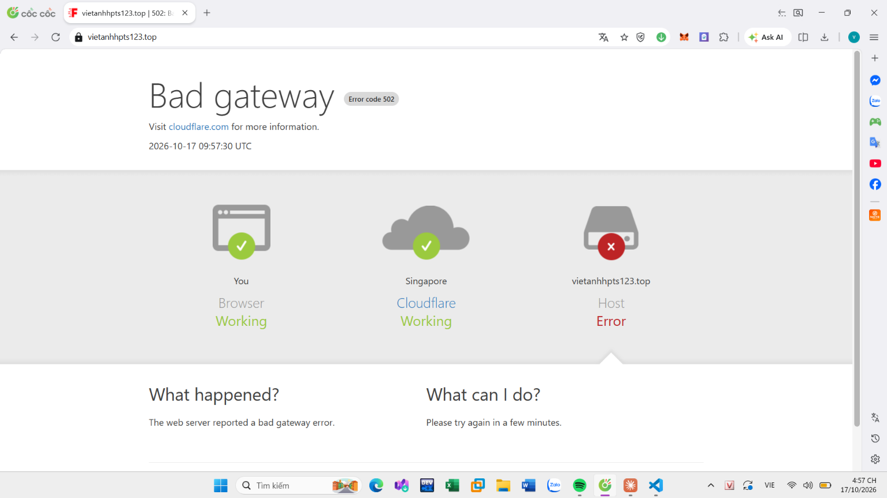

Lưu ý múi giờ: log Nginx và log `journalctl` theo giờ máy chủ (MSK, UTC+3), log container theo UTC, ảnh chụp màn hình theo giờ Việt Nam (UTC+7).

## 2. Hệ thống

```text
User → Cloudflare (Proxy) → Nginx (host, :80/:443) → 127.0.0.1:18096 → container app (:8080) → container db (SQL Server)
```

Docker Compose project `net` gồm: `db`, `db-init`, `app` (`18096:8080`), `prometheus`, `grafana`, `node-exporter`, `cadvisor`.

Tên container do Compose tự đặt theo mẫu `<project>-<service>-<số>` (file compose không có `container_name`), nên `net-app-1` là project `net`, service `app`, bản sao 1.

## 3. Khoanh vùng (từ ngoài vào trong)

| Tầng | Lệnh | Kết quả | Kết luận | Minh chứng |
|---|---|---|---|---|
| User → Cloudflare | `dig +short`, `ping` | Trả về `172.67.131.15`, `104.21.9.234` (dải Cloudflare)<br>ping 0% mất gói | DNS đúng, domain đi qua Cloudflare. Chỉ chứng minh tới edge Cloudflare, chưa nói gì về origin | [MC-02](05_Minh_chung/MC-02_dig_ping_dns_cloudflare.png) |
| Cloudflare → Nginx | `nginx -t`, `systemctl status nginx` | Cú pháp OK<br>`active (running)`<br>Có cảnh báo trùng `server_name` của một site khác trên cổng 80 (`conflicting server name … ignored`) | Nginx đang chạy. Cảnh báo trùng `server_name` cần xem lại, chưa thấy liên quan | [MC-03](05_Minh_chung/MC-03_nginx_t_systemctl_status.png) |
| Nginx → cổng app | `ss -tuln \| grep 18096` | `LISTEN 0.0.0.0:18096` | Có tiến trình giữ cổng | [MC-04](05_Minh_chung/MC-04_ss_tuln_cong_18096.png) |
| Docker | `docker compose ps` | Chỉ thấy 4 container monitoring và `net-web-1`<br>**Không có `app`, `db`** | Stack thật (app + db) không chạy tại thời điểm đó. `docker compose ps` mặc định chỉ liệt kê container đang chạy | [MC-05](05_Minh_chung/MC-05_compose_ps_truoc_khi_up.png) |
| Docker | `cat docker-compose.yml` | `app` publish `"18096:8080"`<br>`db` **không có** `restart`<br>`app` và `db-init` phụ thuộc theo điều kiện | Cấu hình cổng đúng. Service tên `app`, trong khi container đang chạy tên `net-web-1` (tên service cũ) | [MC-06](05_Minh_chung/MC-06_docker_compose_yml_phan_1.png), [MC-07](05_Minh_chung/MC-07_docker_compose_yml_phan_2.png) |
| Docker | `docker compose up -d --build` | `net-app-1 Started`, `net-db-1 Healthy`, cảnh báo **orphan containers `net-web-1`** | `net-web-1` là container của lần dựng trước (service `web` đã đổi tên thành `app`), vẫn mang nhãn project `net` nên vẫn hiện | [MC-08](05_Minh_chung/MC-08_compose_up_build.png) |
| Docker | `docker compose ps` (sau up) | `net-app-1` `Up 1 second`, cột PORTS **trống**<br>`net-web-1` `Up 5 seconds`, PORTS trống | `net-app-1` không có cổng publish nào hiển thị, xem các dòng `docker inspect` bên dưới | [MC-09](05_Minh_chung/MC-09_compose_ps_sau_khi_up.png) |
| Container app | `docker logs net-app-1 \| grep -E "TCP/IP connection\|Caused by"` | `SQLServerException: The TCP/IP connection to the host db, port 1433 has failed<br>Error: "db<br>Verify the connection properties…"` | Phần `Error: "db"` là tên host không phân giải được (`UnknownHostException`), không phải `Connection refused`. Đây là cách đọc dựa trên định dạng thông báo của driver JDBC, được củng cố bởi các dòng `docker inspect` và `getent` bên dưới | [MC-10](05_Minh_chung/MC-10_docker_logs_net_app.png), [MC-13](05_Minh_chung/MC-13_docker_logs_net_app_loi_goc.png) |
| Container db | `docker ps -a`, `docker logs --tail 30 net-db-1` | `net-db-1` `Up 23 hours (healthy)`, `1433/tcp`<br>log SQL Server bình thường, database `Fastshop` đã khởi động | DB đang sống. Loại trừ kịch bản "DB đã sập" | [MC-14](05_Minh_chung/MC-14_docker_logs_net_db.png) |
| Network | `docker network inspect net_default` | Có `grafana`, `prometheus`, `cadvisor`, `node-exporter` và `net-db-1` (`172.24.0.5`)<br>**Không có `net-app-1`** | `net-app-1` không nằm trong network của db | [MC-15](05_Minh_chung/MC-15_network_inspect_net_default.png) |
| Container app | `docker inspect net-app-1` (Networks, PortBindings, Labels) | `Networks` = `{}`<br>`PortBindings` = `8080/tcp → 18096`<br>`config_files` = `…/net/docker-compose.yml`<br>`net-app-1` `Up 36 seconds`, `net-web-1` `Up 16 seconds` | Container được tạo đúng từ file compose hiện tại và khai báo cổng đúng, nhưng lúc chụp **không gắn vào network nào** | [MC-17](05_Minh_chung/MC-17_docker_inspect_net_app.png) |
| Nginx → cổng app | `ss -tulpn \| grep 18096` | `docker-proxy` (pid 1538150) giữ cổng | Cổng do Docker publish, không phải tiến trình lạ | [MC-11](05_Minh_chung/MC-11_ss_tulpn_docker_proxy_18096.png) |
| docker-proxy | `ps -p 1538150 -o args=` | `docker-proxy … -host-port 18096 -container-ip 172.24.0.5 -container-port 8080` | Cổng 18096 đang chuyển tới `172.24.0.5:8080`. IP này hiện là của **`net-db-1`** (SQL Server, không có gì ở cổng 8080) | [MC-16](05_Minh_chung/MC-16_docker_proxy_container_ip.png) |
| Nginx | `tail -n 20 /var/log/nginx/error.log` | `recv() failed (104 …) while reading response header from upstream`, `server: vietanhhpts123.top`, `upstream: "http://127.0.0.1:18096/"` | `proxy_pass` đúng cổng 18096. Nginx kết nối được nhưng kết nối bị reset khi chờ phản hồi | [MC-12](05_Minh_chung/MC-12_nginx_error_log.png) |
| Container app | `docker inspect` (NetworkMode, RestartCount), `docker exec net-app-1 getent hosts db`, `docker compose up -d --force-recreate app` | `net_default running restarts=1299`<br>`getent hosts db` **không in gì**<br>tạo lại app báo `failed to set up container networking … failed to bind host port 0.0.0.0:18096/tcp: address already in use` | Container được cấu hình gắn `net_default` nhưng lúc chạy không phân giải được `db`. Khi tạo lại, cổng 18096 đã bị chiếm. 1299 lần khởi động lại cho thấy app sập liên tục | [MC-18](05_Minh_chung/MC-18_force_recreate_loi_bind_cong_18096.png) |
| docker-proxy | `docker ps \| grep 18096`, `ps -p 1538150 -o pid,lstart,etime,args`, `docker inspect net-web-1` (PortBindings) | Không container nào đang publish 18096<br>proxy khởi động `Tue Oct 20 09:59:28 2026`, chạy hơn 26 giờ<br>`net-web-1` chỉ có `8000/tcp → 8000` | Proxy giữ cổng không thuộc container nào đang chạy, nên là proxy cũ còn sót. `net-web-1` không tranh cổng 18096 | [MC-19](05_Minh_chung/MC-19_xac_nhan_proxy_va_net_web_cong_8000.png) |
| Nginx bị bỏ qua | `docker inspect net-app-1 -f '{{.State.Error}}'`, `curl -sv http://127.0.0.1:18096` | `State.Error` = `failed to bind host port 0.0.0.0:18096/tcp: address already in use` (trùng mã endpoint với MC-18)<br>`curl`: `Recv failure: Connection reset by peer` | `curl` tái hiện đúng lỗi `104` của Nginx mà không cần Nginx hay Cloudflare, nên lỗi nằm từ `docker-proxy` trở vào. `State.Error` chỉ là lần tạo lại, không nói về các lần khởi động lại trước | [MC-20](05_Minh_chung/MC-20_state_error_va_curl_reset_by_peer.png) |
| Log Docker daemon | `journalctl -u docker --since "2026-10-20" \| grep 18096` | 20/10 09:59:57: `restartmanger wait error: failed to set up container networking … endpoint net-app-1 (c49be43d…): failed to start userland proxy for port mapping 0.0.0.0:18096:172.24.0.5:8080/tcp: timed out starting the userland proxy`<br>21/10 12:02:50–51: `failed to bind host port 0.0.0.0:18096/tcp: address already in use` (lần tạo lại)<br>Chỉ có 4 dòng khớp 18096 | **Sự kiện khởi đầu:** Docker không khởi động kịp proxy cho `net-app-1` (IP `172.24.0.5`) và bỏ dở việc dựng network, 29 giây sau khi proxy 1538150 được tạo (09:59:28). Cả ngày không có lỗi bind lặp lại, nên 1299 lần sập không phải do mỗi lần đụng lỗi bind | [MC-21](05_Minh_chung/MC-21_journalctl_docker_userland_proxy.png) |
| Sửa | `kill 1538150`, `ss -tulpn \| grep 18096`, `docker compose up -d --force-recreate app`, `docker compose ps` | `ss` không in gì<br>`net-db-1 Healthy`, `net-app-1 Started`<br>`net-app-1` `Up 8 seconds`, PORTS `0.0.0.0:18096->8080/tcp, [::]:18096->8080/tcp`<br>`net-web-1` vẫn `Up 58 seconds` | Cổng 18096 đã được giải phóng và `net-app-1` publish được cổng. Chưa chứng minh app chạy khỏe và website hết 502 | [MC-22](05_Minh_chung/MC-22_kill_proxy_va_recreate_app.png) |

Ảnh `docker ps -a` đầy đủ không đưa vào repo vì có tên container của người khác trên cùng server. Thông tin cần dùng từ ảnh đó: `net-db-1` `Up 23 hours (healthy)`, `net-db-init-1` `Exited (0)`, `net-app-1` `Up 4 seconds` và cột PORTS trống. Ảnh lọc theo `net-` ở MC-17 thay cho ảnh đó.

### Ảnh minh chứng

Ảnh MC-03 và MC-12 đã che tên các site khác trên cùng server; các ảnh còn lại để nguyên. Ảnh MC-01 nằm ở phần 1.

#### A. Từ người dùng tới Nginx

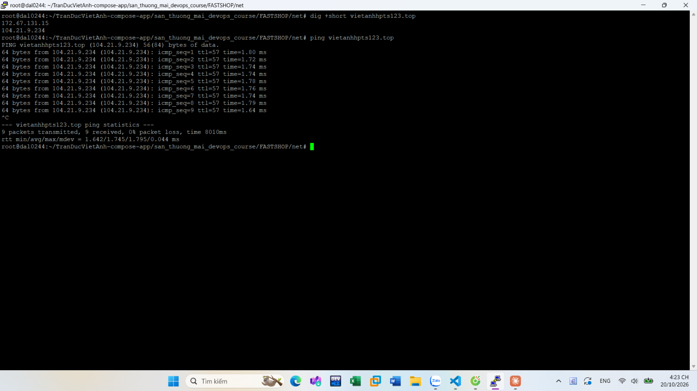

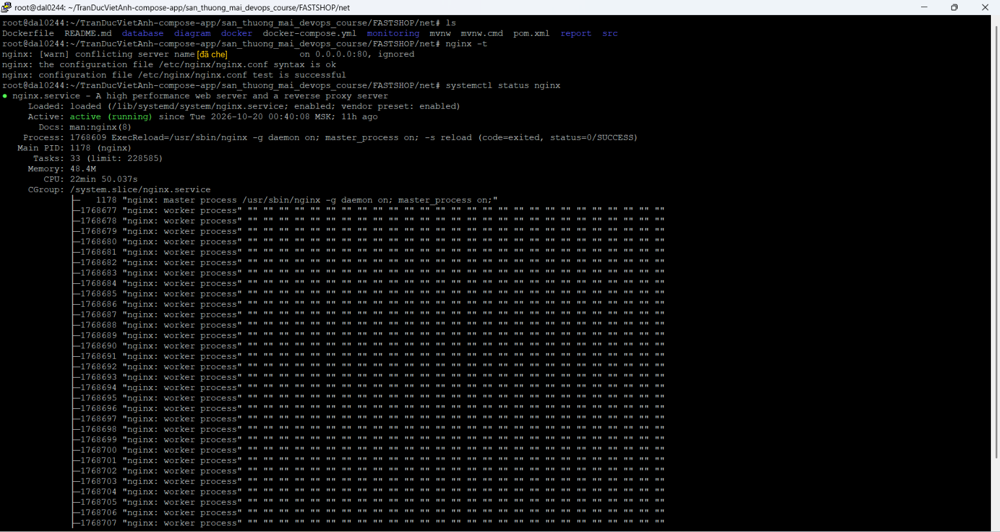

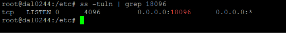

#### B. Docker và file compose

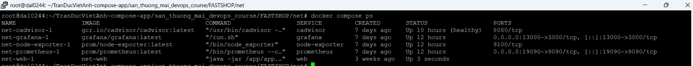

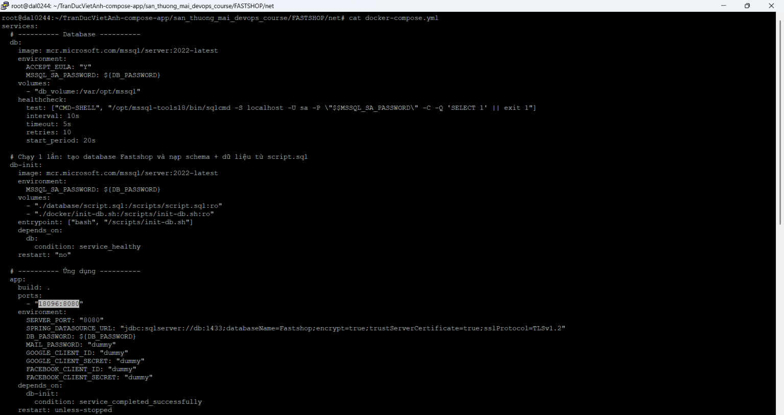

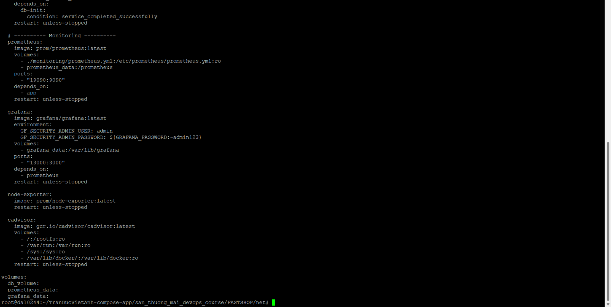

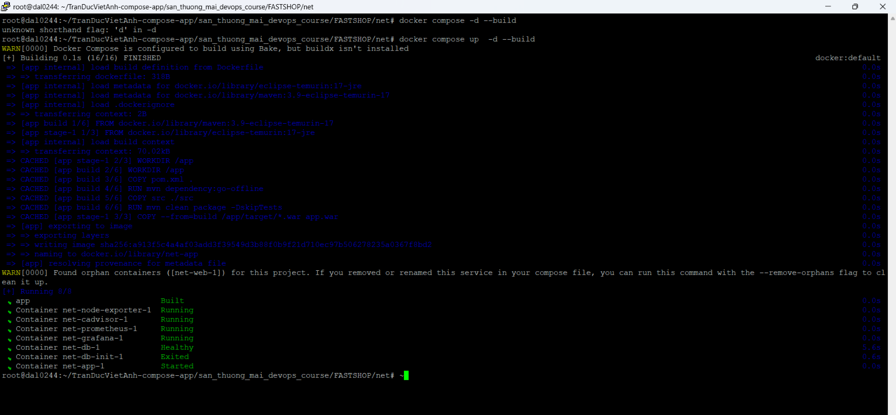

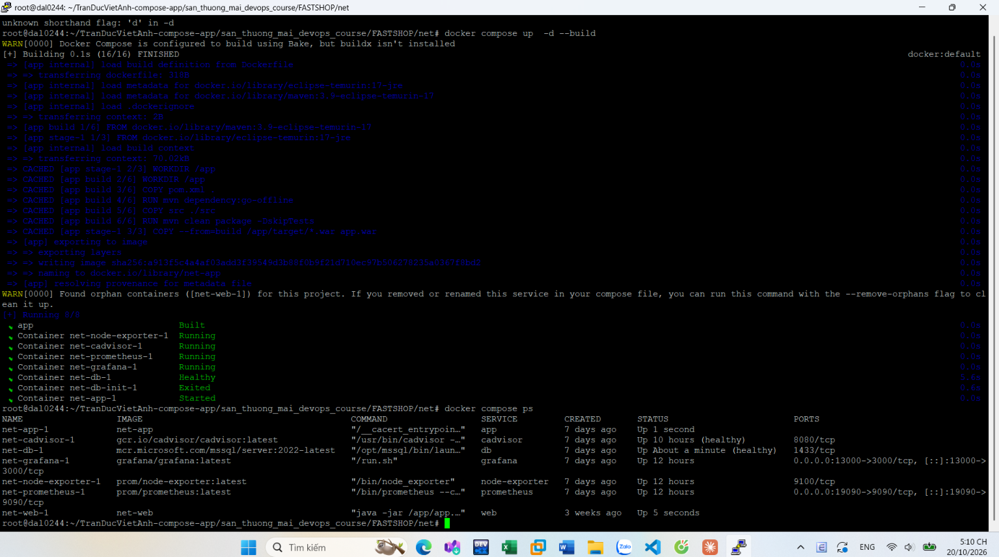

#### C. Container app, database và network

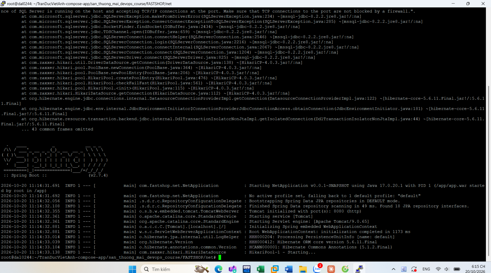

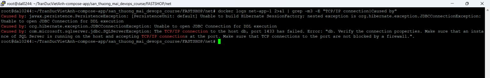

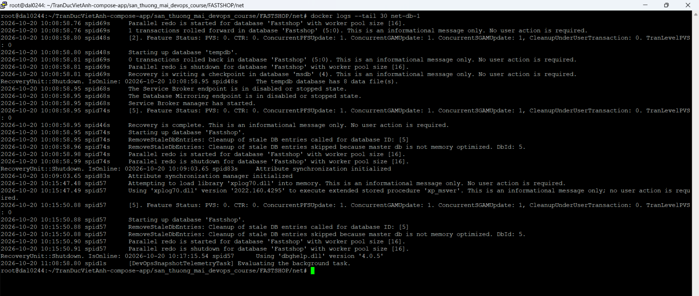

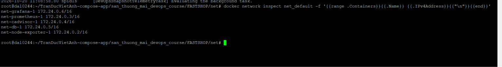

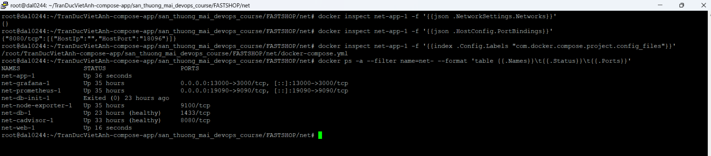

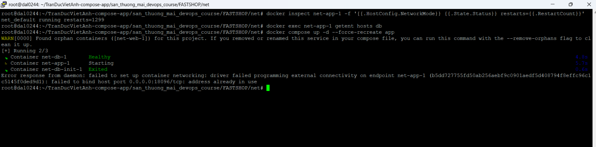

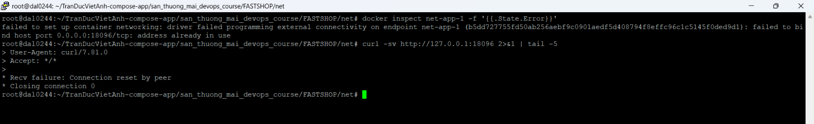

#### D. Cổng 18096 và docker-proxy

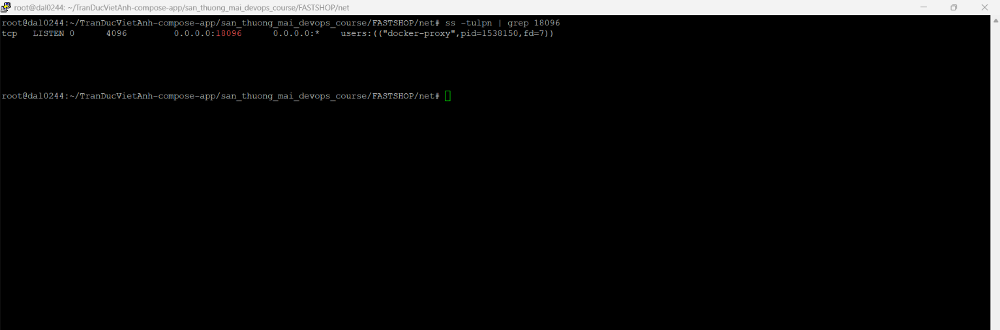

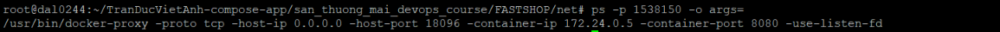

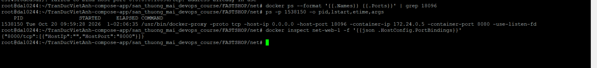

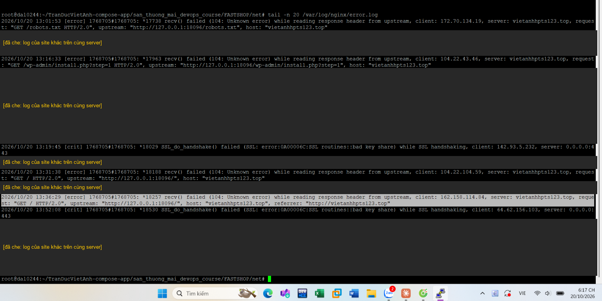

#### E. Log Docker daemon và bước sửa

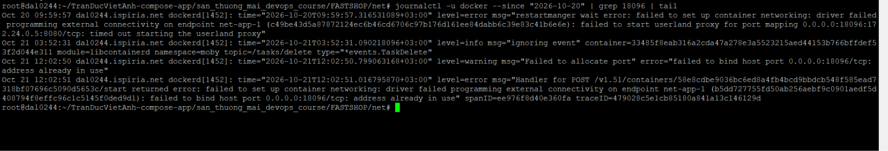

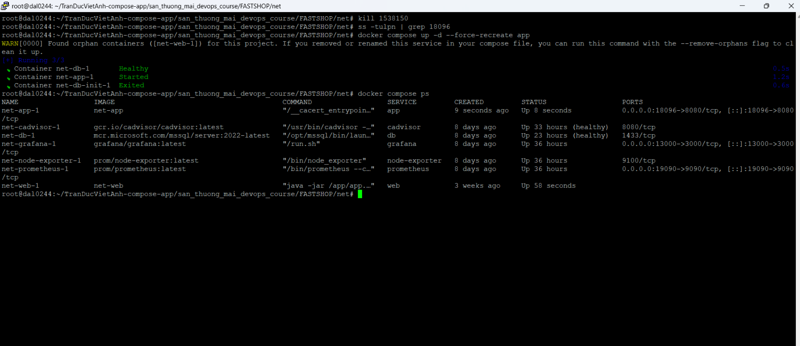

### Cơ chế gây ra sự cố

**Sự kiện khởi đầu (20/10):**

1. 09:59:28, Docker tạo `docker-proxy` (pid 1538150) chuyển cổng 18096 của host tới `172.24.0.5:8080`, IP của `net-app-1` lúc đó.
2. 09:59:57, `dockerd` báo `timed out starting the userland proxy` cho `net-app-1`. Docker coi việc dựng network của container là thất bại.
3. Tiến trình proxy không bị dọn mà tiếp tục sống hơn 26 giờ, giữ cổng 18096 (quan sát trực tiếp: proxy còn chạy; "không bị dọn vì lần khởi động bị coi là lỗi" là suy luận).
4. `net-app-1` từ đó chạy mà không có network (`Networks = {}`), không phân giải được `db`, sập và khởi động lại 1299 lần (khoảng một lần mỗi phút). Việc app sập vì không thấy `db` là suy luận từ log `UnknownHostException` và `getent`.
5. `net-db-1` khởi động lại lúc 13:09 giờ server và nhận IP `172.24.0.5` (suy luận: IP này đã được giải phóng). Proxy cũ vì thế chuyển vào container database.

**Vì sao người dùng thấy 502:**

1. Nginx gọi `127.0.0.1:18096`, `docker-proxy` nhận kết nối.
2. `docker-proxy` chuyển tới `172.24.0.5:8080`, tức container database, nơi không có dịch vụ nào ở cổng 8080, nên kết nối bị đóng ngay.
3. Nginx ghi `104` (connection reset) và trả 502. Cloudflare nhận 502 và hiện trang lỗi. Đoạn 1–3 tái hiện được ngay trên server mà không qua Nginx hay Cloudflare: `curl -sv http://127.0.0.1:18096` báo `Recv failure: Connection reset by peer` ([MC-20](05_Minh_chung/MC-20_state_error_va_curl_reset_by_peer.png)).

Mã lỗi giúp phân biệt: nếu cổng không ai giữ thì Nginx ghi `111 Connection refused`. Ở đây là `104` nên cổng có người giữ (`docker-proxy`) nhưng phía sau không có app trả lời.

## 4. Nguyên nhân gốc

_Lúc 09:59 ngày 20/10, Docker không khởi động kịp `docker-proxy` cho `net-app-1` (`timed out starting the userland proxy`). Proxy bị bỏ lại, tiếp tục giữ cổng 18096 và sau đó chuyển vào IP `172.24.0.5` khi IP này được cấp cho container database. Hai hậu quả: Nginx → 18096 bị reset nên 502; `net-app-1` chạy không có network nên không thấy `db` và sập liên tục. Chưa biết vì sao Docker không khởi động kịp proxy._

## 5. Cách khắc phục

Đã làm theo thứ tự, không khởi động lại Docker daemon vì server chạy nhiều container của người khác:

```bash
kill 1538150                                   # dừng docker-proxy cũ
ss -tulpn | grep 18096                         # không còn dòng nào
docker compose up -d --force-recreate app      # tạo lại app, không đụng volume của db
```

Trước khi `kill`, đã xác nhận không container nào đang chạy publish cổng 18096 ([MC-19](05_Minh_chung/MC-19_xac_nhan_proxy_va_net_web_cong_8000.png)). Kết quả: [MC-22](05_Minh_chung/MC-22_kill_proxy_va_recreate_app.png).

## 6. Kiểm chứng

Đã thấy: `docker compose ps` hiện `net-app-1` `Up` với `0.0.0.0:18096->8080/tcp` ([MC-22](05_Minh_chung/MC-22_kill_proxy_va_recreate_app.png)).

_Chưa có: log app khởi động xong, `getent hosts db`, `curl` vào 127.0.0.1:18096 và vào https://vietanhhpts123.top. Điền sau khi chạy lại các lệnh kiểm tra._

## 7. Bài học và phòng ngừa

_Bản nháp, cần đối chiếu với ý của chủ hệ thống:_

1. **`restart: unless-stopped` che giấu sự cố.** `net-app-1` sập 1299 lần mà vẫn hiện `Up` vài giây. Nên theo dõi `RestartCount` và thêm `healthcheck` cho `app` (hiện chỉ `db` có).
2. **Cần giám sát từ bên ngoài.** Lỗi được ghi nhận ngày 17/10 và còn tới 21/10. Một công cụ kiểm tra HTTP định kỳ có cảnh báo sẽ phát hiện sớm hơn.
3. **Dọn container orphan sau khi đổi tên service** (`docker compose up -d --remove-orphans`), để container cũ không tiếp tục khởi động lại liên tục và gây nhiễu khi chẩn đoán.
4. **Khi Docker báo lỗi network hoặc cổng**, đọc theo thứ tự `journalctl -u docker`, `ss -tulpn`, `ps -p <pid> -o args=`. Không khởi động lại daemon trên server dùng chung.
5. **Rủi ro khác thấy được trong lúc dò:** `db` không có `restart`, nên sẽ không tự dậy lại sau khi server khởi động lại.

## 8. So với Câu 51

_Đối chiếu tạm thời, cập nhật sau khi kiểm chứng xong._

| Giả thuyết trong Câu 51 | Ca thực tế |
|---|---|
| 1. Lỗi DNS | Loại trừ: `dig` trả về IP Cloudflare |
| 2. Nginx sai cú pháp hoặc không chạy | Loại trừ: `nginx -t` đạt, Nginx `active (running)`, `proxy_pass` đúng cổng 18096 |
| 3. Container API: chưa chạy, map sai port, app lỗi | Đúng nhóm này và gần với "map sai port" hơn dự đoán: khai báo `18096:8080` trong compose đúng, nhưng cổng 18096 bị một `docker-proxy` cũ chiếm và chuyển nhầm vào container DB. Vì vậy app không có network và không phân giải được tên `db` |

Câu 51 sửa lỗi bằng cách đổi `proxy_pass` cho khớp cổng được map. Ca thực tế không sửa được theo cách đó vì Nginx đã trỏ đúng; phải giải phóng cổng 18096.

**Những điều ca thực tế cho thấy mà Câu 51 chưa nêu:**

1. **Đọc mã lỗi trong `error.log` để thu hẹp trước khi vào Docker.** `111 Connection refused` nghĩa là cổng không ai giữ. `104 Connection reset` nghĩa là cổng có người giữ (ở đây là `docker-proxy`) nhưng phía sau không có app trả lời. Ca này là `104`.
2. **`docker ps` chỉ liệt kê container đang chạy.** Container đã thoát hoặc khởi động lại liên tục dễ bị bỏ sót, nên dùng `docker ps -a`.
3. **Cổng ở trạng thái `LISTEN` không chứng minh app còn sống.** `docker-proxy` mở cổng kể cả khi container phía sau không phục vụ. Cần `ss -tulpn` để biết ai giữ cổng, `ps -p <pid> -o args=` để biết proxy chuyển tới IP nào, và `curl` thẳng vào cổng để biết app có trả lời.
4. **`docker logs` cho biết triệu chứng, log Docker daemon cho biết sự kiện khởi đầu.** Câu 51 kỳ vọng `docker logs` cho kết quả "bình thường". Ở ca thực tế, `docker logs` cho thấy app không tìm thấy `db`, còn nguyên nhân khởi đầu chỉ nằm trong `journalctl -u docker`.
5. **Đọc kỹ chuỗi `Error: "…"` trong exception của JDBC.** `Error: "Connection refused"` là DB không nghe cổng, còn `Error: "db"` là tên host không phân giải được. Hai lỗi này dẫn tới hai hướng sửa khác hẳn nhau.
6. **Kiểm tra network của container, không chỉ cấu hình.** Compose khai báo đúng cổng và đúng service, nhưng `docker inspect` mới cho thấy container thực tế không gắn network nào. Khai báo đúng chưa chắc trạng thái chạy đúng.
7. **Hai triệu chứng có thể chung một nguyên nhân.** Nginx nhận 502 và app sập liên tục đều xuất phát từ cùng một proxy cũ còn sót. Nếu chỉ sửa một triệu chứng (ví dụ sửa kết nối DB của app) thì lỗi vẫn còn.
8. **`restart: unless-stopped` che giấu sự cố.** Container sập 1299 lần vẫn hiện `Up` vài giây nên dễ tưởng đang chạy. Nên nhìn `RestartCount` và `docker logs`.
9. **Lỗi `address already in use` có chủ.** Dùng `ss -tulpn` và `ps -p <pid> -o args=` để tìm tiến trình đang chiếm cổng, không đoán.
10. **Lỗi 502 có thể bắt nguồn từ tầng dưới backend.** Chuỗi phụ thuộc (app → database) và network giữa các container cũng cần được kiểm tra, không chỉ Nginx và container API.
11. **Phân biệt dữ kiện quan sát và suy luận.** Trong ca này có ít nhất hai lần suy luận ban đầu cần chỉnh lại khi có thêm log (PID `docker-proxy` so với PID Nginx; lỗi bind là nguyên nhân của 1299 lần sập). Ghi rõ đâu là quan sát, đâu là suy luận giúp sửa kết luận mà không phải viết lại toàn bộ báo cáo.
